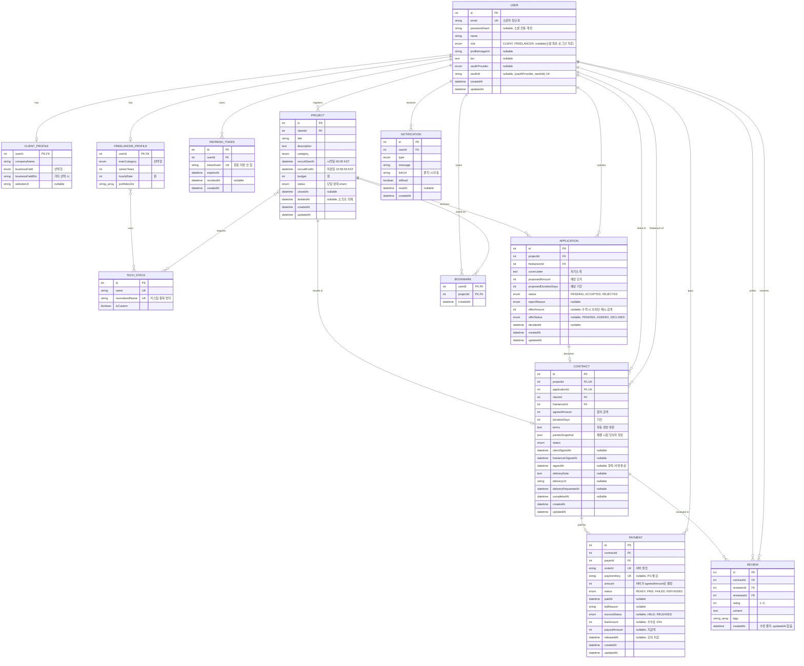

# WorkBridge ERD 초안

> 근거: RFP 2부 §4 데이터 모델 개요(엔티티 분리·통합·명명은 팀 자율), §3 기능 요구사항, §7.1 보안
> 이 문서는 설계 초안이다. 확정 후 dbdiagram.io 또는 draw.io로 옮겨 제출용 ERD(O-04)를 만든다.

## 1. 설계 원칙

1. **RFP의 8개 엔티티를 뼈대로 쓴다.** User, Project, Application, Contract, Payment, Review, Notification, Bookmark
2. **보조 엔티티는 꼭 필요한 것만 둔다.** 아래 4개 외에는 추가하지 않는다.
3. **도전 과제용 구조는 미리 만들지 않는다.** 다회차 협상(C-03)용 제안 테이블, 관리자 테이블 등은 착수할 때 추가한다.
4. 금액은 원 단위 정수, 시각은 UTC로 저장하고 화면에서 KST로 표시한다(D-41, D-42).

### 1.1 보조 엔티티 (최소)

| 엔티티 | 필요한 이유 | 대안 (D-48) |
|---|---|---|
| ClientProfile | 의뢰인 전용 필드(회사명, 사업 분야, 웹사이트)를 User에서 분리 | User에 nullable 컬럼으로 통합 |
| FreelancerProfile | 프리랜서 전용 필드(카테고리, 경력, 단가, 포트폴리오)와 기술 스택 관계 | User에 nullable 컬럼으로 통합 |
| TechStack | 기술 스택 옵션 선택 + 커스텀 추가(A-11), 기술 스택 필터(A-21), 유사 기술 추천(A-41) | 문자열 배열로만 저장(필터·중복 정리가 어려움) |
| RefreshToken | 서버 측 Refresh Token 무효화·재발급(A-03, A-04) | User에 토큰 해시 1개만 저장(다중 기기 로그인 불가) |

- Project–TechStack, FreelancerProfile–TechStack의 다대다 관계는 Prisma 암시적 다대다로 둔다. 연결 테이블은 Prisma가 만든다.
- **두지 않는 것:** 소셜 계정 테이블(User의 `oauthProvider`, `oauthId` 컬럼으로 충분, 제공자 1종 기준), 금액 제안 테이블(Application의 제안 필드로 충분), 정산 테이블(RFP가 Payment를 "결제와 정산 내역"으로 정의), 납품 테이블(1회 요청·승인이면 Contract 필드로 충분, D-19), 상태 이력 테이블(필수 아님), AI 분석 결과 테이블(D-27에서 저장하기로 결정할 때만 추가).

---

## 2. Mermaid ERD

---

## 3. 상태 모델

### 3.1 저장 방식 (D-03 추천안)

RFP 3.2.3은 단일 enum과 별도 필드 중 팀이 고르도록 했다. 추천안은 **Project에 단일 상태 enum**을 두고, 거래 단계의 세부 진행은 **Application의 제안 상태와 Contract 상태**로 표현하는 것이다. 외부 노출 규칙(A-26)을 한 곳에서 매핑하기 쉽고, 상태 조합이 어긋날 여지가 적다.

| Project.status | 의미 (RFP) | 외부 목록 표시 (A-26) | 세부 진행 표현 |
|---|---|---|---|
| `SCHEDULED` | 모집 예정 | 모집 예정 | - |
| `RECRUITING` | 모집 중 | 모집 중 | - |
| `CLOSED` | 모집 마감 | 모집 마감 | - |
| `CONTRACTING` | 계약 대기 | 모집 마감 | `Application.offerStatus = PENDING`(금액 합의 중) → `Contract.status = SIGNATURE_PENDING`(서명 대기) → `SIGNED`(결제 대기) |
| `IN_PROGRESS` | 작업 중 | 모집 마감 | `Contract.status = IN_PROGRESS` → `DELIVERY_REQUESTED`(납품 요청됨) |
| `COMPLETED` | 완료 | 모집 마감 | `Contract.status = COMPLETED`, `Payment.escrowStatus = RELEASED` |
| `CANCELLED` | 취소 | 노출 안 함 (D-13) | 서명 전 계약은 `Contract.status = CANCELLED` |

- '결제 대기'를 Project 상태로 분리하지 않고 `Contract.status = SIGNED`로 표현한다(D-04). RFP 정의상 '작업 중'의 조건이 "양측 서명 + 결제 완료"이므로, 서명만 끝난 상태는 여전히 '계약 대기'다.

### 3.2 enum 목록 (초안)

| enum | 값 |
|---|---|
| UserRole | `CLIENT`, `FREELANCER` |
| OAuthProvider | `GOOGLE` 또는 `KAKAO` (D-23에서 1종 확정) |
| ProjectCategory | `WEB`, `MOBILE`, `DESIGN`, `MARKETING`, `DATA_AI`, `PLANNING`, `ETC` (초안, 팀 확정) |
| BusinessField | `IT`, `COMMERCE`, `EDUCATION`, `FINANCE`, `HEALTHCARE`, `MEDIA`, `MANUFACTURING`, `ETC` (초안, 'ETC'는 자유 입력) |
| ProjectStatus | `SCHEDULED`, `RECRUITING`, `CLOSED`, `CONTRACTING`, `IN_PROGRESS`, `COMPLETED`, `CANCELLED` |
| ApplicationStatus | `PENDING`(검토중), `ACCEPTED`(수락), `REJECTED`(거절) — RFP의 3가지 표시 상태와 1:1 |
| RejectReason | `MANUAL`, `OTHER_ACCEPTED`, `PROJECT_CLOSED`, `NEGOTIATION_FAILED`, `PROJECT_CANCELLED` ([팀 결정] 거절 사유 표시용, 없어도 RFP 충족) |
| OfferStatus | `PENDING`, `AGREED`, `DECLINED` |
| ContractStatus | `SIGNATURE_PENDING`, `SIGNED`, `IN_PROGRESS`, `DELIVERY_REQUESTED`, `COMPLETED`, `CANCELLED` |
| PaymentStatus | `READY`, `PAID`, `FAILED`, `REFUNDED`(C-02 또는 수동 변경용) |
| EscrowStatus | `HELD`, `RELEASED` |
| NotificationType | 필수 5종: `APPLICATION_SUBMITTED`, `APPLICATION_ACCEPTED`, `APPLICATION_AUTO_REJECTED`, `APPLICATION_REJECTED`, `PROJECT_CLOSED` (+ C-01 착수 시 추가) |

### 3.3 상태 전환과 데이터 변경

| 이벤트 | Project | Application | Contract | Payment | 알림 |
|---|---|---|---|---|---|
| 등록 | 시작일 기준 `SCHEDULED`/`RECRUITING` | - | - | - | - |
| 시작일 도래 | `SCHEDULED`→`RECRUITING` | - | - | - | - |
| 마감(자동·수동) | →`CLOSED` | `PENDING`→`REJECTED(PROJECT_CLOSED)` | - | - | ⑤ (자동 마감은 D-36) |
| 지원 | - | 생성 `PENDING` | - | - | ① |
| 직접 거절 | - | →`REJECTED(MANUAL)` | - | - | ④ |
| 수락 + 금액 입력 | `RECRUITING`→`CONTRACTING` | 대상 `ACCEPTED` + `offerStatus=PENDING`, 나머지 `PENDING`→`REJECTED(OTHER_ACCEPTED)` | - | - | ②, ③ |
| 금액 거부 | →`RECRUITING` 또는 `CLOSED` (D-10) | 대상 `REJECTED(NEGOTIATION_FAILED)`, `offerStatus=DECLINED` | - | - | (C-01) |
| 금액 동의 | 유지 `CONTRACTING` | `offerStatus=AGREED` | 생성 `SIGNATURE_PENDING` | - | (C-01) |
| 양측 서명 | 유지 `CONTRACTING` | - | →`SIGNED` | - | (C-01) |
| 결제 승인 | →`IN_PROGRESS` | - | →`IN_PROGRESS` | `PAID`, `escrowStatus=HELD` | (C-01) |
| 납품 요청 | - | - | →`DELIVERY_REQUESTED` | - | (C-01) |
| 완료 승인 | →`COMPLETED` | - | →`COMPLETED` | `escrowStatus=RELEASED`, 수수료·지급액 기록 | (C-01) |
| 취소 | →`CANCELLED` | `PENDING`/제안 중 지원 처리 (D-13) | 서명 전이면 →`CANCELLED` | - | (팀 결정) |

- 한 이벤트의 모든 변경(상태, 부수 효과, 알림 생성)은 **한 DB 트랜잭션**에서 처리한다. 중간에 실패하면 알림도 남지 않는다.

---

## 4. 무결성·권한 설계

### 4.1 중복·동시성 방지

| 규칙 | 요구사항 | DB 수준 | 서비스 수준 |
|---|---|---|---|
| 같은 프로젝트 중복 지원 금지 | A-29 | `UNIQUE(Application.projectId, freelancerId)` | 위반 시 409 |
| 프로젝트당 수락 1건 | A-33 | (선택) `applications(projectId) WHERE status='ACCEPTED'` 부분 유니크 인덱스 | 수락 트랜잭션에서 프로젝트 행을 잠그고(`SELECT … FOR UPDATE`) `RECRUITING`인지 확인 |
| 프로젝트당 계약 1건 | B-06 | `UNIQUE(Contract.projectId)`, `UNIQUE(Contract.applicationId)` | 결렬 시에는 계약을 만들지 않으므로 1건으로 충분 |
| 계약당 결제 완료 1건 | B-09 | `UNIQUE(Payment.orderId)`, (선택) `payments(contractId) WHERE status='PAID'` 부분 유니크 | 같은 orderId 재승인 요청은 기존 결과 반환(멱등) |
| 리뷰 1회 | B-18 | `UNIQUE(Review.contractId, reviewerId)` | 수정·삭제 API를 만들지 않음 |
| 북마크 중복 | A-39 | 복합 PK `(userId, projectId)` | 이미 있으면 성공으로 처리 |
| 커스텀 기술 스택 중복 | A-11, A-12 | `UNIQUE(TechStack.normalizedName)` | 대소문자·공백 정규화 후 기존 항목 재사용 |

- 부분 유니크 인덱스와 CHECK 제약(예산·금액 > 0, 별점 1~5, 시작일 ≤ 마감일)은 Prisma 스키마로 표현하기 어려우므로 필요하면 SQL 마이그레이션으로 추가한다. 서비스 검증만으로도 RFP는 충족한다.

### 4.2 계약·결제 금액 무결성 (B-06, B-09, B-14)

1. 계약 금액은 프리랜서가 동의한 `Application.offerAmount`를 서버가 `Contract.agreedAmount`로 복사한다. 클라이언트가 보낸 금액을 쓰지 않는다.
2. 결제 금액은 서버가 `Contract.agreedAmount`로 정해 `Payment`를 만든다. 결제창에 넘기는 금액도 서버 응답 값이다.
3. PG 콜백을 받으면 서버가 **DB의 결제 금액과 콜백 금액을 대조**한 뒤 PG 승인 API를 호출하고, 승인 응답 금액도 다시 대조한다. 다르면 `FAILED`로 기록한다.
4. 결제는 계약이 `SIGNED`이고 요청자가 그 계약의 의뢰인일 때만 만들 수 있다.
5. 정산: `feeAmount = floor(amount × 10%)`, `payoutAmount = amount − feeAmount`(D-18). 두 값의 합은 항상 결제 금액과 같다.
6. 계약서의 당사자 정보는 체결 시점 값을 `partiesSnapshot`에 고정해, 이후 프로필을 바꿔도 계약서 내용이 바뀌지 않게 한다(D-15).

### 4.3 소프트 삭제 (A-17)

- `Project.deletedAt`만 둔다. 다른 엔티티는 삭제 기능이 없다.
- 목록·상세·추천·북마크 목록 조회에서 `deletedAt IS NULL` 조건을 기본으로 건다.
- 지원서·알림·북마크가 프로젝트를 참조하므로 Project에는 cascade 삭제를 걸지 않는다. 물리 삭제 API는 만들지 않는다.
- 삭제된 프로젝트에 지원했던 프리랜서의 '내 지원 현황'에는 기록이 남는다(A-35). 표시 방식은 D-07.

### 4.4 권한 매트릭스 (A-08, N-05)

| 리소스 | 조회 | 생성 | 수정·상태 변경 |
|---|---|---|---|
| 프로젝트 | 누구나(삭제·취소 제외) | 의뢰인 | 소유 의뢰인 |
| 지원서 | 작성한 프리랜서, 해당 프로젝트 소유 의뢰인 | 프리랜서(모집 중 프로젝트, D-34) | 수락·거절: 소유 의뢰인 / 금액 동의·거부: 작성 프리랜서 |
| 계약서 | 양 당사자 | 시스템(금액 동의 시) | 서명: 각 당사자 / 납품 요청: 프리랜서 / 완료 승인: 의뢰인 |
| 결제 | 결제한 의뢰인, 계약의 프리랜서(정산 정보) | 계약의 의뢰인 | 시스템(PG 검증) |
| 리뷰 | 누구나(공개 프로필) | 완료된 계약의 당사자 | 불가 |
| 알림 | 수신자 | 시스템 | 읽음 처리: 수신자 |
| 북마크 | 본인 | 프리랜서(D-31) | 본인 |
| 프로필 | 공개 프로필은 누구나(이메일 제외, D-15) | - | 본인 |

- 남의 리소스에 접근하면 존재 여부를 숨기기 위해 404로 응답하는 것을 추천한다(팀 결정).

---

## 5. 인덱스 초안 (조회 성능 최소한)

| 테이블 | 인덱스 | 용도 |
|---|---|---|
| Project | `(status, recruitEndAt)` | 목록 상태 필터, 마감임박순, 자동 마감 대상 조회 |
| Project | `(status, recruitStartAt)` | 자동 모집 시작 대상 조회 |
| Project | `(category)`, `(createdAt)`, `(budget)`, `(clientId)` | 필터·정렬·내 프로젝트 |
| Application | `(projectId, status)`, `(freelancerId, createdAt)` | 지원 관리, 내 지원 현황 |
| Notification | `(userId, isRead, createdAt)` | 미확인 수, 알림 목록 |
| Review | `(revieweeId, createdAt)` | 공개 프로필 리뷰 목록·평균 |

키워드 검색은 MVP에서 `ILIKE`(제목·설명 부분 일치)로 충분하다. 데이터가 많아지면 전문 검색을 검토한다.
