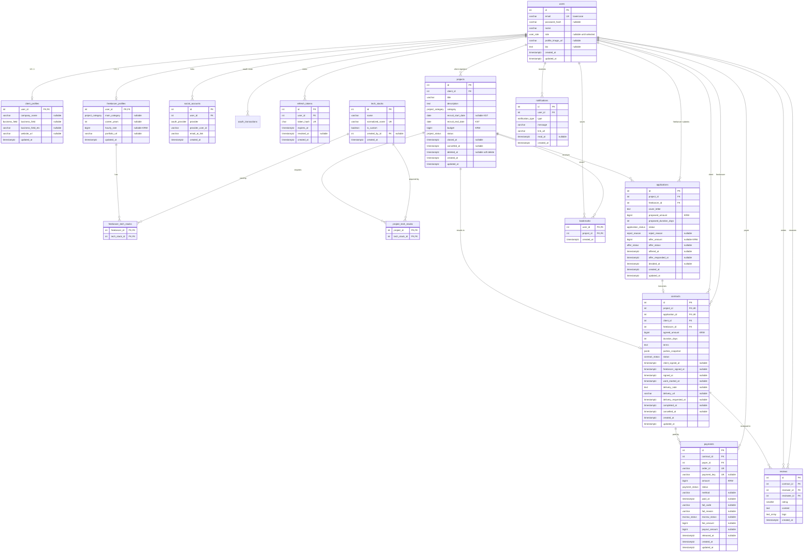

# WorkBridge ERD v1

> 상태: **설계 v1 + STEP 03-B 부분 구현.** 15개 중 9개 테이블(사용자·인증·프로필·기술 스택·프로젝트)을 첫 마이그레이션 `20261012083722_init_database_foundation`으로 로컬 PostgreSQL 18에 적용했다. 나머지 6개는 해당 기능 단계에서 추가한다. 구현과 설계의 차이는 §7에 있다.
> 근거: RFP 2부 §3·§4·§7, [DECISIONS.md](./DECISIONS.md)의 확정 항목, [ERD_DRAFT.md](./ERD_DRAFT.md)(초안, 이 문서로 대체)
> DB: PostgreSQL. 타입은 PostgreSQL 기준으로 적고, Prisma 매핑은 §6에 정리한다.
> 고정 기술 스택(D-02)이 확인되지 않았으므로 DB·ORM 선택은 잠정이다.

## 0. 초안 대비 변경 사항 (변경 근거)

| # | 초안(ERD_DRAFT) | v1 | 근거 |
|---|---|---|---|
| 1 | User에 `oauthProvider`, `oauthId` 컬럼 | **SocialAccount 테이블** 분리 | "Google 우선"이므로 두 번째 제공자를 추가할 수 있다. 한 사용자가 여러 소셜 계정을 연동해도 User를 바꾸지 않아도 된다(D-57) |
| 2 | 기술 스택 다대다를 Prisma 암시적 연결로 처리 | **명시적 연결 테이블** ProjectTechStack, FreelancerTechStack | 제출용 ERD에 연결 테이블이 드러나고, 테이블 이름을 팀이 정할 수 있다 |
| 3 | 모집 시작·마감을 `timestamptz`(00:00 / 23:59:59 KST)로 저장 | **`date` 타입**(KST 날짜) | 사용자는 날짜만 입력한다. 시각 변환 실수(UTC 자정 문제)를 없앤다(D-41, D-58) |
| 4 | 프로필 필수 컬럼을 NOT NULL로 가정 | **프로필 컬럼은 nullable**, 완성 여부는 서비스 함수가 판정 | 필수 항목(D-05)이 아직 미확정이다. DB를 바꾸지 않고 판정 함수만 고치면 되게 한다 |
| 5 | `portfolioUrls` 배열 | `portfolioUrl` 단일 값 | RFP 3.1.3은 "포트폴리오 URL"만 요구한다. 단순화 |
| 6 | Notification `isRead` + `readAt` | `readAt`만 사용 (`NULL` = 미확인) | 같은 정보를 두 컬럼에 두면 어긋날 수 있다 |
| 7 | 수락 1건 부분 유니크 인덱스는 "선택" | **필수** | STEP 02 요구: 프로젝트별 수락 대상 1명 제한을 DB가 보장 |
| 8 | 결제 완료 1건 부분 유니크 인덱스는 "선택" | **필수** + 조건부 UPDATE | STEP 02 요구: 결제 성공 중복 처리 방지 |
| 9 | 정산 금액은 서비스 계산만 | 서비스 계산 + **CHECK 제약**(수수료 + 지급액 = 결제액) | 계산 실수를 DB에서 한 번 더 막는다 |
| 10 | Contract 시각 필드 일부 | `workStartedAt`, `cancelledAt` 추가 | 작업 시작일 = 결제 완료일(D-14), 취소 시점 기록 |
| 11 | (v1 최초) 금액 컬럼 `integer` | **`bigint`** (STEP 03-A 변경) | D-51 확정. 대상 8개: `hourly_rate`, `budget`, `proposed_amount`, `offer_amount`, `agreed_amount`, `amount`, `fee_amount`, `payout_amount`. `integer` 최대값(약 21억 원)이 사실상 금액 상한이 되는 문제를 없앤다. 정산 계산은 BigInt로 변경(§5 #7, §6) |

---

## 1. 테이블 목록

| 구분 | 테이블 | 역할 | 선정 근거 |
|---|---|---|---|
| 핵심 | `users` | 계정, 역할, 공통 프로필 | RFP §4 |
| 핵심 | `projects` | 프로젝트 정보, 상태 | RFP §4 |
| 핵심 | `applications` | 지원서 + 금액 제안(1회) | RFP §4, D-11 |
| 핵심 | `contracts` | 계약서, 서명, 납품 | RFP §4 |
| 핵심 | `payments` | 결제 + 에스크로 정산 | RFP §4("결제와 정산 내역"), D-17 |
| 핵심 | `reviews` | 상호 평가 | RFP §4 |
| 핵심 | `notifications` | 인앱 알림 | RFP §4 |
| 핵심 | `bookmarks` | 북마크 | RFP §4 |
| 보조 | `client_profiles` | 의뢰인 전용 프로필 | 역할별 필드를 User에서 분리(D-48) |
| 보조 | `freelancer_profiles` | 프리랜서 전용 프로필 | 역할별 필드를 User에서 분리(D-48) |
| 보조 | `tech_stacks` | 기술 스택 옵션 + 커스텀 | 옵션 선택·커스텀 추가(A-11), 필터(A-21), 추천(A-41)에 공통 사용 |
| 연결 | `project_tech_stacks` | 프로젝트 ↔ 기술 스택 다대다 | 프로젝트 필요 기술(A-15) |
| 연결 | `freelancer_tech_stacks` | 프리랜서 ↔ 기술 스택 다대다 | 프리랜서 보유 기술(A-11) |
| 보조 | `social_accounts` | 소셜 로그인 연동 | Google 우선 + 계정 연동(A-05, A-06, D-57) |
| 보조 | `oauth_transactions` | OAuth state·연동 확인 | PKCE·nonce·일회용 10분(A-05, A-06, D-71). STEP 04-B |
| 보조 | `refresh_tokens` | Refresh Token 저장·무효화 | 재발급·로그아웃 무효화(A-03, A-04, D-26) |

**총 16개** (핵심 8 + 보조 6 + 연결 2). STEP 04-B에서 `oauth_transactions`를 추가했다. 두지 않는 테이블과 이유는 ERD_DRAFT §1.1과 같다(금액 제안, 정산, 납품, 상태 이력, AI 결과 테이블 없음).

---

## 2. Mermaid ERD

---

## 3. 테이블 정의

표기: **NULL** 열의 `N`은 nullable, `-`는 NOT NULL. 모든 `id`는 `integer GENERATED ALWAYS AS IDENTITY`(자동 증가). 모든 `timestamptz`는 UTC로 저장하고 화면에서 KST로 표시한다(D-41).

### 3.1 users

| 컬럼 | 타입 | NULL | 기본값 | 제약 | 설명 |
|---|---|---|---|---|---|
| id | integer | - | identity | PK | |
| email | varchar(255) | - | | UNIQUE | 저장 전 소문자·공백 제거 정규화 |
| password_hash | varchar(255) | N | | | bcrypt 해시. 소셜로만 가입한 계정은 NULL (N-01) |
| name | varchar(50) | - | | | |
| role | user_role | N | | | `CLIENT`, `FREELANCER`. 소셜 최초 로그인 직후만 NULL (A-07) |
| profile_image_url | varchar(500) | N | | | 스토리지 공개 URL (A-09) |
| bio | text | N | | | 자기소개 |
| created_at | timestamptz | - | now() | | |
| updated_at | timestamptz | - | now() | | |

- 역할은 한 번 정하면 바꾸지 않는다(RFP 3.1.3 "모든 사용자는 두 역할 중 하나"). 역할 변경 API는 없다.

### 3.2 social_accounts

| 컬럼 | 타입 | NULL | 기본값 | 제약 | 설명 |
|---|---|---|---|---|---|
| id | integer | - | identity | PK | |
| user_id | integer | - | | FK → users.id (ON DELETE CASCADE) | |
| provider | oauth_provider | - | | | `GOOGLE` (추가 제공자는 enum 값 추가) |
| provider_user_id | varchar(255) | - | | | Google `sub` |
| email_at_link | varchar(255) | - | | | 연동 시점에 제공자가 **인증 완료**로 확인한 이메일 |
| created_at | timestamptz | - | now() | | |

- UNIQUE `(provider, provider_user_id)`: 같은 Google 계정이 두 사용자에 연결되지 않는다.
- UNIQUE `(user_id, provider)`: 한 사용자는 제공자당 계정 1개만 연동한다.

### 3.2.1 oauth_transactions (STEP 04-B)

| 컬럼 | 타입 | NULL | 기본값 | 제약 | 설명 |
|---|---|---|---|---|---|
| id | integer | - | identity | PK | |
| kind | oauth_transaction_kind | - | | | `LOGIN`(Google 진행) 또는 `LINK`(계정 연결 확인) |
| token_hash | char(64) | - | | UNIQUE | 쿠키 원문(`state` 또는 연동 토큰)의 SHA-256 |
| code_verifier | varchar(255) | N | | | PKCE verifier. LOGIN 동안만 |
| nonce | varchar(255) | N | | | OIDC nonce. LOGIN 동안만 |
| return_to | varchar(500) | N | | | 검증된 내부 경로 |
| provider_user_id | varchar(255) | N | | | 연결할 Google `sub`. LINK만 |
| email | varchar(255) | N | | | 연결 시점 이메일. LINK만 |
| user_id | integer | N | | FK → users.id (CASCADE) | 연결 대상. LOGIN은 NULL |
| expires_at | timestamptz | - | | | 10분 |
| created_at | timestamptz | - | now() | | |

- 콜백·연결 확인에 성공하면 행을 삭제한다(일회용). Google 토큰 원문은 저장하지 않는다.

### 3.3 refresh_tokens

| 컬럼 | 타입 | NULL | 기본값 | 제약 | 설명 |
|---|---|---|---|---|---|
| id | integer | - | identity | PK | |
| user_id | integer | - | | FK → users.id (CASCADE) | |
| token_hash | char(64) | - | | UNIQUE | SHA-256 해시. 원문은 저장하지 않는다 |
| expires_at | timestamptz | - | | | |
| revoked_at | timestamptz | N | | | 재발급(교체)·로그아웃 시 기록 |
| created_at | timestamptz | - | now() | | |

- 인덱스 `(user_id)`. 이미 무효화된 토큰으로 재발급을 시도하면 해당 사용자의 토큰을 모두 무효화한다(탈취 의심).

### 3.4 client_profiles

| 컬럼 | 타입 | NULL | 제약 | 설명 |
|---|---|---|---|---|
| user_id | integer | - | PK, FK → users.id (CASCADE) | 역할이 `CLIENT`인 사용자만 (서비스 검증) |
| company_name | varchar(100) | N | | |
| business_field | business_field | N | | 선택형 |
| business_field_etc | varchar(100) | N | CHECK: `business_field = 'ETC'`일 때만 값 허용 | '기타' 자유 입력 |
| website_url | varchar(500) | N | | |
| updated_at | timestamptz | - | | |

### 3.5 freelancer_profiles

| 컬럼 | 타입 | NULL | 제약 | 설명 |
|---|---|---|---|---|
| user_id | integer | - | PK, FK → users.id (CASCADE) | 역할이 `FREELANCER`인 사용자만 |
| main_category | project_category | N | | 프로젝트 카테고리와 같은 enum 사용(추천 매칭에 활용) |
| career_years | integer | N | CHECK `>= 0` | 경력(년수) |
| hourly_rate | bigint | N | CHECK `> 0` | 시간당 단가(원). 상한 없음(D-42) |
| portfolio_url | varchar(500) | N | | |
| updated_at | timestamptz | - | | |

> 프로필 완성 판정(A-13): DB가 아니라 서비스 함수 `getMissingProfileFields(user)` 하나에서 판단한다. D-05가 확정되면 이 함수만 바꾼다. 추천안 기준 필수 항목은 다음과 같다. 의뢰인: `company_name`, `business_field`(ETC면 `business_field_etc`). 프리랜서: `main_category`, 기술 스택 1개 이상, `career_years`, `hourly_rate`.

### 3.6 tech_stacks, project_tech_stacks, freelancer_tech_stacks

| 테이블 | 컬럼 | 타입 | NULL | 제약 |
|---|---|---|---|---|
| tech_stacks | id | integer | - | PK |
| | name | varchar(50) | - | 표시 이름(예: `React`) |
| | normalized_name | varchar(50) | - | UNIQUE. 소문자 + 공백·점·하이픈 제거(예: `node.js` → `nodejs`) |
| | is_custom | boolean | - | 기본 false. 사용자가 추가한 항목이면 true |
| | created_by_id | integer | N | FK → users.id (ON DELETE SET NULL) |
| | created_at | timestamptz | - | |
| project_tech_stacks | project_id | integer | - | PK(복합), FK → projects.id |
| | tech_stack_id | integer | - | PK(복합), FK → tech_stacks.id, 인덱스 |
| freelancer_tech_stacks | freelancer_id | integer | - | PK(복합), FK → freelancer_profiles.user_id (CASCADE) |
| | tech_stack_id | integer | - | PK(복합), FK → tech_stacks.id, 인덱스 |

- 기본 옵션은 시드로 넣고, 유사 기술은 통합한다(A-12, 예: `SQL`). 커스텀 추가 시 `normalized_name`이 같으면 기존 항목을 재사용한다.

### 3.7 projects

| 컬럼 | 타입 | NULL | 기본값 | 제약 | 설명 |
|---|---|---|---|---|---|
| id | integer | - | identity | PK | |
| client_id | integer | - | | FK → users.id (RESTRICT) | 등록한 의뢰인 |
| title | varchar(100) | - | | | |
| description | text | - | | | 키워드 검색 대상 |
| category | project_category | - | | | |
| recruit_start_date | date | N | | | KST 날짜. NULL이면 등록 즉시 모집 중 (A-24) |
| recruit_end_date | date | - | | CHECK `recruit_start_date IS NULL OR recruit_start_date <= recruit_end_date` | KST 날짜. 그날 23:59:59까지 모집 |
| budget | bigint | - | | CHECK `> 0` | 원. 상한 없음(D-42) |
| status | project_status | - | | | 7개 상태(D-03) |
| closed_at | timestamptz | N | | | 모집 마감 시각(자동·수동·수락) |
| cancelled_at | timestamptz | N | | | |
| deleted_at | timestamptz | N | | | 소프트 삭제(A-17, D-53) |
| created_at | timestamptz | - | now() | | |
| updated_at | timestamptz | - | now() | | |

인덱스:
- `(status, recruit_end_date) WHERE deleted_at IS NULL`: 목록 상태 필터, 마감임박순, 자동 마감 대상
- `(status, recruit_start_date) WHERE deleted_at IS NULL`: 자동 모집 시작 대상
- `(category)`, `(created_at DESC)`, `(budget DESC)`: 필터·정렬
- `(client_id, created_at DESC)`: 내 프로젝트
- 키워드 검색은 `ILIKE '%키워드%'`(제목·설명)로 시작한다. 느려지면 `pg_trgm` 인덱스를 검토한다.

### 3.8 applications

| 컬럼 | 타입 | NULL | 기본값 | 제약 | 설명 |
|---|---|---|---|---|---|
| id | integer | - | identity | PK | |
| project_id | integer | - | | FK → projects.id (RESTRICT) | |
| freelancer_id | integer | - | | FK → users.id (RESTRICT) | |
| cover_letter | text | - | | | 자기소개 |
| proposed_amount | bigint | - | | CHECK `> 0` | 예상 단가(원) |
| proposed_duration_days | integer | - | | CHECK `> 0` | 예상 기간(일, D-46) |
| status | application_status | - | `PENDING` | | `PENDING`(검토중), `ACCEPTED`(수락), `REJECTED`(거절) |
| reject_reason | reject_reason | N | | CHECK: `status = 'REJECTED'`일 때만 값 | 직접·자동·마감·결렬·취소 구분(D-49) |
| offer_amount | bigint | N | | CHECK `> 0` | 의뢰인이 수락 시 제시한 합의 금액(D-11) |
| offer_status | offer_status | N | | | `PENDING`, `AGREED`, `DECLINED` |
| offered_at | timestamptz | N | | | |
| offer_responded_at | timestamptz | N | | | |
| decided_at | timestamptz | N | | | 수락·거절 시각 |
| created_at, updated_at | timestamptz | - | now() | | |

제약·인덱스:
- **UNIQUE `(project_id, freelancer_id)`**: 동일 프로젝트 중복 지원 방지(A-29)
- **부분 UNIQUE `(project_id) WHERE status = 'ACCEPTED'`**: 프로젝트당 수락 1명(A-33). 금액 결렬 시 수락 지원이 `REJECTED`로 바뀌므로 다음 수락이 가능하다 (STEP 06-B 구현: `applications_one_accepted_per_project`, §7.7)
- CHECK `status <> 'ACCEPTED' OR (offer_amount IS NOT NULL AND offer_status IS NOT NULL)`: 수락에는 반드시 제안 금액이 있다
- 인덱스 `(project_id, status)`: 지원 관리, 일괄 거절 대상 조회
- 인덱스 `(freelancer_id, created_at DESC)`: 내 지원 현황

### 3.9 contracts

| 컬럼 | 타입 | NULL | 제약 | 설명 |
|---|---|---|---|---|
| id | integer | - | PK | |
| project_id | integer | - | FK → projects.id, **UNIQUE** | 프로젝트당 계약 1건 |
| application_id | integer | - | FK → applications.id, **UNIQUE** | |
| client_id | integer | - | FK → users.id | 조회 권한 판단용(중복이지만 조회가 단순해짐) |
| freelancer_id | integer | - | FK → users.id | |
| agreed_amount | bigint | - | CHECK `> 0` | 서버가 `applications.offer_amount`에서 복사(B-06) |
| duration_days | integer | - | CHECK `> 0` | 지원서의 예상 기간에서 복사(D-14) |
| terms | text | - | | 자동 생성 계약 본문 |
| parties_snapshot | jsonb | - | | 생성 시점의 양측 이름·이메일·회사명(D-15) |
| status | contract_status | - | | 기본 `SIGNATURE_PENDING` |
| client_signed_at | timestamptz | N | | |
| freelancer_signed_at | timestamptz | N | | |
| signed_at | timestamptz | N | | 양측 서명 완료 = **계약 체결**(D-13) |
| work_started_at | timestamptz | N | | 결제 승인 시각(D-14) |
| delivery_note | text | N | | 납품 메모 |
| delivery_url | varchar(500) | N | | 납품물 링크 |
| delivery_requested_at | timestamptz | N | | |
| completed_at | timestamptz | N | | 완료 승인 시각 |
| cancelled_at | timestamptz | N | | 체결 전 취소 시각 |
| created_at, updated_at | timestamptz | - | | |

- CHECK `client_id <> freelancer_id`
- CHECK `signed_at IS NULL OR (client_signed_at IS NOT NULL AND freelancer_signed_at IS NOT NULL)`
- 인덱스 `(client_id, created_at DESC)`, `(freelancer_id, created_at DESC)`: 내 계약 목록

### 3.10 payments

| 컬럼 | 타입 | NULL | 제약 | 설명 |
|---|---|---|---|---|
| id | integer | - | PK | |
| contract_id | integer | - | FK → contracts.id | |
| payer_id | integer | - | FK → users.id | 계약의 의뢰인 |
| order_id | varchar(64) | - | **UNIQUE** | 서버 생성 주문 번호(예: `wb_` + 랜덤) |
| payment_key | varchar(200) | N | **UNIQUE** | PG 발급 결제 키(승인 후) |
| amount | bigint | - | CHECK `> 0` | 서버가 `contracts.agreed_amount`로 결정 |
| status | payment_status | - | | `READY`, `PAID`, `FAILED`, `REFUNDED` |
| method | varchar(30) | N | | PG 응답의 결제 수단 |
| paid_at | timestamptz | N | | |
| fail_code, fail_reason | varchar | N | | 실패 기록 |
| escrow_status | escrow_status | N | | `HELD`(보관), `RELEASED`(지급 처리) |
| fee_amount | bigint | N | CHECK `>= 0` | 수수료(10%) |
| payout_amount | bigint | N | CHECK `>= 0` | 프리랜서 지급액 |
| released_at | timestamptz | N | | 모의 지급 처리 시각 |
| created_at, updated_at | timestamptz | - | | |

- **부분 UNIQUE `(contract_id) WHERE status = 'PAID'`**: 계약당 결제 성공 1건(B-09)
- **부분 UNIQUE `(contract_id) WHERE status = 'READY'`** (STEP 10-A): 동시 결제 시작 시 READY 주문 1건만(재사용)
- CHECK `status <> 'PAID' OR (payment_key IS NOT NULL AND paid_at IS NOT NULL AND escrow_status IS NOT NULL)`
- CHECK `escrow_status <> 'RELEASED' OR (fee_amount + payout_amount = amount)`: 정산 합계 검증(B-14)
- 통화 KRW는 API DTO로 고정(컬럼 없음). `project_id`는 `contracts` 경유
- 인덱스 `(payer_id, created_at DESC)`: 결제 내역, `(contract_id)`
- 마이그레이션: `20261016200000_payments_sandbox`, `20261016201000_payments_one_ready`

### 3.11 reviews

| 컬럼 | 타입 | NULL | 제약 | 설명 |
|---|---|---|---|---|
| id | integer | - | PK | |
| contract_id | integer | - | FK → contracts.id | |
| reviewer_id | integer | - | FK → users.id | 작성자 |
| reviewee_id | integer | - | FK → users.id | 대상. **서버가 계약의 상대방으로 결정** |
| rating | smallint | - | CHECK `BETWEEN 1 AND 5` | |
| content | text | - | | |
| tags | text[] | - | 기본 `{}` | 역할별 태그 목록(D-20)에 있는 값만 허용(서비스 검증) |
| created_at | timestamptz | - | | `updated_at` 없음 = 수정 불가(B-18) |

- **UNIQUE `(contract_id, reviewer_id)`**: 작성자별 1회(B-18)
- CHECK `reviewer_id <> reviewee_id`
- 인덱스 `(reviewee_id, created_at DESC)`: 공개 프로필 리뷰 목록·평균 별점(B-19)
- 마이그레이션: `20261019120000_reviews` (STEP 11). `project_id` 컬럼 없음 — `contracts` 경유

### 3.12 notifications

| 컬럼 | 타입 | NULL | 제약 | 설명 |
|---|---|---|---|---|
| id | integer | - | PK | |
| user_id | integer | - | FK → users.id (CASCADE) | 수신자 |
| type | notification_type | - | | 필수 5종(+ C-01 착수 시 추가) |
| message | varchar(255) | - | | 표시 문구 |
| link_url | varchar(255) | - | | 클릭 시 이동할 FE 경로(D-36) |
| read_at | timestamptz | N | | NULL이면 미확인 |
| created_at | timestamptz | - | | |

- 인덱스 `(user_id, created_at DESC)`: 알림 목록
- 부분 인덱스 `(user_id) WHERE read_at IS NULL`: 헤더 미확인 수(A-37)
- STEP 06-C 구현에서 `title`, `project_id`, `application_id`, `event_key`(UNIQUE), `link_url` CHECK를 더했다(§7.8, D-103·D-104 제안).

### 3.13 bookmarks

| 컬럼 | 타입 | NULL | 제약 |
|---|---|---|---|
| user_id | integer | - | PK(복합), FK → users.id (CASCADE) |
| project_id | integer | - | PK(복합), FK → projects.id, 인덱스 |
| created_at | timestamptz | - | |

- 복합 PK가 중복 북마크를 막는다(A-39). 삭제된 프로젝트는 목록에서 제외한다.
- STEP 07-A 구현에서 `project_id` FK를 CASCADE로 정하고, 목록용 인덱스 `(user_id, created_at DESC, project_id DESC)`를 더했다. 삭제·취소된 프로젝트의 행은 지우지 않고 목록에서만 거른다(§7.9, D-107 제안).

---

## 4. enum 정의

| enum | 값 | 상태 |
|---|---|---|
| user_role | `CLIENT`, `FREELANCER` | 확정(RFP) |
| oauth_provider | `GOOGLE` | 확정(D-23) |
| project_status | `SCHEDULED`, `RECRUITING`, `CLOSED`, `CONTRACTING`, `IN_PROGRESS`, `COMPLETED`, `CANCELLED` | 확정(D-03) |
| application_status | `PENDING`, `ACCEPTED`, `REJECTED` | 확정(RFP 3.2.4) |
| reject_reason | `MANUAL`, `OTHER_ACCEPTED`, `PROJECT_CLOSED`, `NEGOTIATION_FAILED`, `PROJECT_CANCELLED`, `PROJECT_DELETED` | 제안(D-49) |
| offer_status | `PENDING`, `AGREED`, `DECLINED` | 확정(D-11) |
| contract_status | `SIGNATURE_PENDING`, `SIGNED`(= 결제 대기), `IN_PROGRESS`, `DELIVERY_REQUESTED`, `COMPLETED`, `CANCELLED` | 확정(D-04) |
| payment_status | `READY`, `PAID`, `FAILED`, `REFUNDED` | 확정(D-04, D-17) |
| escrow_status | `HELD`, `RELEASED` | 제안(D-17) |
| notification_type | `APPLICATION_SUBMITTED`, `APPLICATION_ACCEPTED`, `APPLICATION_AUTO_REJECTED`, `APPLICATION_REJECTED`, `PROJECT_CLOSED` | 확정(RFP 3.3.1) |
| project_category | `WEB`, `MOBILE`, `DESIGN`, `MARKETING`, `DATA_AI`, `PLANNING`, `ETC` | **제안(D-59)** |
| business_field | `IT`, `COMMERCE`, `EDUCATION`, `FINANCE`, `HEALTHCARE`, `MEDIA`, `MANUFACTURING`, `ETC` | **제안(D-59)** |

---

## 5. 무결성 검토 (STEP 02 요구 7가지)

| # | 조건 | DB 보장 | 서버 보장 | 테스트 |
|---|---|---|---|---|
| 1 | 동일 프로젝트 중복 지원 방지 | UNIQUE `applications(project_id, freelancer_id)` | 지원 전 조회 → 409 `ALREADY_APPLIED`. 동시 요청은 UNIQUE 위반(P2002)을 409로 변환 | 같은 요청 2회·동시 2회 → 1건만 생성 |
| 2 | 프로젝트별 수락 대상 1명 | 부분 UNIQUE `applications(project_id) WHERE status='ACCEPTED'` | 수락 트랜잭션 첫 단계에서 프로젝트 행 잠금(`SELECT … FOR UPDATE`) → `status = RECRUITING` 확인 | 서로 다른 지원 2건 동시 수락 → 1건 성공, 1건 409 |
| 3 | 자동 거절과 알림 생성의 원자성 | 하나의 트랜잭션 | 수락 트랜잭션 안에서 ① 대상 `ACCEPTED` ② 나머지 `PENDING` → `REJECTED(OTHER_ACCEPTED)` ③ 프로젝트 `CONTRACTING` ④ 알림 ②·③ `createMany`. 어느 단계든 실패하면 전체 롤백 | 알림 생성 단계에서 강제 실패 → 상태도 바뀌지 않음 |
| 4 | 리뷰 작성자별 중복 방지 | UNIQUE `reviews(contract_id, reviewer_id)` | 계약 `COMPLETED` 확인, 대상은 서버가 결정, 수정·삭제 API 없음 | 같은 작성자 2회·동시 2회 → 1건 |
| 5 | 계약 체결 전후 수정 권한 | 계약 본문 컬럼을 바꾸는 API 자체가 없음 | 아래 §5.1 표 | 상태별 수정 시도 → 409 |
| 6 | 결제 성공 중복 처리 방지 | UNIQUE `order_id`, UNIQUE `payment_key`, 부분 UNIQUE `(contract_id) WHERE status='PAID'` | 승인 반영은 조건부 UPDATE `WHERE id = ? AND status = 'READY'`. 영향 행 0이면 이미 처리된 것으로 보고 기존 결과를 반환(멱등) | 같은 승인 요청 2회 → 상태 변경 1회, 두 번째는 같은 응답 |
| 7 | 정산 금액과 수수료 10% | CHECK `fee_amount + payout_amount = amount` | `fee = amount / 10n`(BigInt 나눗셈은 소수점 이하를 버림 = floor), `payout = amount - fee`(D-18). Number로 변환하지 않고 BigInt로만 계산(D-51) | 경계값: 1원, 9원, 10원, 15원, 999,999원 |

### 5.1 상태별 수정 권한 (계약 체결 전후)

| 대상 | 수정 가능 시점 | 수정 불가 시점 | 근거 |
|---|---|---|---|
| 프로젝트 일반 필드(제목, 설명, 카테고리, 기술 스택) | `SCHEDULED`, `RECRUITING`, `CLOSED` | `CONTRACTING` 이후 | 거래가 시작되면 계약 근거가 바뀌면 안 됨(D-55, 제안) |
| 프로젝트 예산·마감일 | 위 상태 + 대기·수락 지원이 없을 때 | 지원자가 있을 때, `CONTRACTING` 이후 | RFP 3.2.1, D-06(제안) |
| 지원서 내용 | 수정 기능 없음 | - | RFP에 수정 요구 없음(D-35 철회도 제외) |
| 제안 금액 | 수락 시 1회 입력 | 이후 변경 불가 | D-11 |
| 계약 본문·금액·기간·당사자 | 없음(자동 생성) | 항상 | B-06, D-15 |
| 서명 | 각 당사자 1회 | 서명 후 철회 불가 | B-07 |
| 계약 취소 | `SIGNATURE_PENDING`(체결 전, 의뢰인이 프로젝트 취소 시) | `SIGNED` 이후(체결 후) | RFP 2.3, D-13 |
| 납품 정보 | `IN_PROGRESS`에서 납품 요청 시 1회 | 요청 후 | D-19(제안) |

### 5.2 프로젝트 상태 전환 규칙 (서버 검증, D-52)

모든 상태 변경은 서비스 계층의 전환표 한 곳에서 검사한다. 표에 없는 전환은 409 `INVALID_STATE_TRANSITION`.

| 현재 → 다음 | 트리거 | 주체 | 함께 바뀌는 것 |
|---|---|---|---|
| (신규) → `SCHEDULED` | 등록, 시작일 > 오늘(KST) | 의뢰인 | - |
| (신규) → `RECRUITING` | 등록, 시작일 없음 또는 오늘 | 의뢰인 | - |
| `SCHEDULED` → `RECRUITING` | 시작일 도래 | 시스템 | - |
| `RECRUITING` → `CLOSED` | 마감일 경과 / 수동 마감 | 시스템 / 의뢰인 | 대기 지원 일괄 `REJECTED(PROJECT_CLOSED)` + 알림 ⑤ |
| `RECRUITING` → `CONTRACTING` | 지원자 수락(+ 제안 금액) | 의뢰인 | 자동 거절 + 알림 ②③ |
| `CONTRACTING` → `RECRUITING` / `CLOSED` | 프리랜서 금액 거부(마감일 전 / 후) | 프리랜서 | 지원 `REJECTED(NEGOTIATION_FAILED)` (D-10, 제안) |
| `CONTRACTING` → `IN_PROGRESS` | 결제 승인(계약 `SIGNED` 상태일 때만) | 시스템(PG 검증) | 계약 `IN_PROGRESS`, 결제 `PAID`·`HELD` |
| `IN_PROGRESS` → `COMPLETED` | 완료 승인(계약 `DELIVERY_REQUESTED`일 때만) | 의뢰인 | 계약 `COMPLETED`, 결제 `RELEASED` + 수수료·지급액 |
| `SCHEDULED`/`RECRUITING`/`CLOSED`/`CONTRACTING` → `CANCELLED` | 의뢰인 취소, 단 계약이 체결 전(`SIGNED` 아님)일 때만 | 의뢰인 | 대기 지원 `REJECTED(PROJECT_CANCELLED)`, 서명 전 계약 `CANCELLED` |

- 날짜 판단은 `오늘(KST) = (now() AT TIME ZONE 'Asia/Seoul')::date`로 한다. 마감일 당일은 모집 중이고, 다음 날 0시(KST)부터 마감 대상이다.
- 자동 전환은 cron + 조회 시 보정(D-08, 제안)으로 실행하며, 같은 전환을 두 번 실행해도 결과가 같아야 한다(조건부 UPDATE).

---

## 6. Prisma 매핑 메모 (구현 시 참고)

| 항목 | 방법 |
|---|---|
| 테이블·컬럼 이름 | 모델은 PascalCase, 필드는 camelCase, `@@map("snake_case")`·`@map`으로 DB 이름 지정 |
| `date` 컬럼 | `DateTime @db.Date`. 서버에서는 `'YYYY-MM-DD'` 문자열로 주고받고 KST 오늘 날짜 문자열과 비교 |
| `timestamptz` | `DateTime @db.Timestamptz(3)` |
| 부분 UNIQUE·CHECK 제약 | Prisma 스키마로 표현이 어려운 항목은 마이그레이션 SQL에 직접 추가(설정 단계에서 Prisma 버전의 지원 여부를 확인) |
| 행 잠금 | `$transaction` 안에서 `$queryRaw\`SELECT … FOR UPDATE\`` |
| 금액 | `BigInt`(PostgreSQL `bigint`, D-51). Prisma는 JS `BigInt`로 돌려주므로 `JSON.stringify`가 그대로는 실패한다. 응답 직렬화 시 금액을 **10진수 문자열**로 바꾸고, 요청의 금액 문자열(또는 안전 정수)을 `BigInt`로 바꾸는 변환 함수를 한 곳에 둔다. 계산은 `BigInt`끼리만 한다 |

---

## 7. STEP 03-B 구현 현황 (2026-10-12)

### 7.1 적용 결과

| 항목 | 내용 |
|---|---|
| 스키마 | `apps/api/prisma/schema.prisma` (Prisma 7.10.0) |
| 마이그레이션 | `apps/api/prisma/migrations/20261012083722_init_database_foundation/migration.sql` |
| 적용 DB | `workbridge_dev`(개발), `workbridge_test`(테스트) 각각 `prisma migrate deploy`로 적용. `workbridge_shadow`는 마이그레이션 생성 때만 Prisma가 사용 |
| 생성 테이블 (9) | `users`, `social_accounts`, `refresh_tokens`, `client_profiles`, `freelancer_profiles`, `tech_stacks`, `freelancer_tech_stacks`, `project_tech_stacks`, `projects` |
| enum (5) | `user_role`, `oauth_provider`, `project_status`(7개 값), `project_category`, `business_field` |
| 외래키 (10) | §3 표의 FK 전부. ON DELETE 규칙은 아래 §7.2 |
| UNIQUE (5) | `users.email`, `social_accounts(provider, provider_user_id)`, `social_accounts(user_id, provider)`, `refresh_tokens.token_hash`, `tech_stacks.normalized_name` (+ 연결 테이블 2개의 복합 PK) |
| CHECK (5, SQL 수동 추가) | `client_profiles_business_field_etc_check`, `freelancer_profiles_career_years_check`(`>= 0`), `freelancer_profiles_hourly_rate_check`(`> 0`), `projects_budget_check`(`> 0`), `projects_recruit_dates_check` |
| 인덱스 | §3.7의 projects 인덱스 6개(부분 인덱스 2개 포함), `refresh_tokens(user_id)`, 연결 테이블의 `tech_stack_id` |
| 타입 | 금액 `bigint`(`budget`, `hourly_rate`), 모집일 `date`, 그 밖의 시각 `timestamptz(3)`(UTC). `timestamp without time zone` 컬럼은 없다 |
| 검증 | 실제 DB 카탈로그 조회 + 통합 테스트 22개(`apps/api/test/db/`) 통과 |

아직 만들지 않은 테이블: ~~`applications`~~(STEP 06-A, §7.6), ~~`contracts`~~(STEP 09-A), ~~`payments`~~(STEP 10-A, `20261016200000_payments_sandbox`), `reviews`, ~~`notifications`~~(STEP 06-C, §7.8), ~~`bookmarks`~~(STEP 07-A, §7.9). STEP 10-A는 `payments`와 `payment_status`·`escrow_status` enum, 계약당 `PAID`/`READY` 부분 UNIQUE를 추가했다. 정산 지급(`RELEASED`)·납품은 이후 단계다.

### 7.3 STEP 04-B (2026-10-13)

| 항목 | 내용 |
|---|---|
| 마이그레이션 | `apps/api/prisma/migrations/20261013030539_oauth_transactions/migration.sql` |
| 추가 | `oauth_transaction_kind` enum, `oauth_transactions` 테이블. `DROP`·사용자 삭제는 없다 |
| 적용 | `workbridge_dev`, `workbridge_test`에 `prisma migrate deploy` |
| UNIQUE | `oauth_transactions.token_hash`. 기존 `social_accounts(provider, provider_user_id)`, `(user_id, provider)`는 그대로다 |

### 7.4 STEP 04-B-2 역할별 프로필 (2026-10-13)

| 항목 | 내용 |
|---|---|
| 마이그레이션 | **없음.** `users`(`name`, `bio`, `profile_image_url`), `client_profiles`, `freelancer_profiles`, `tech_stacks`, `freelancer_tech_stacks`를 그대로 쓴다 |
| RFP·DB 충돌 | 없음. 필수 항목(D-05) 컬럼은 nullable로 두고 서비스(`getMissingProfileFields`)가 완성 여부를 판정한다(§0 #4). 설계에 없는 컬럼(의뢰인 연락처 등)은 추가하지 않았다 |
| 기술 스택 연결 | 저장 시 존재하는 ID인지 확인한 뒤 `freelancer_tech_stacks`를 요청 목록으로 교체. 복합 PK가 중복을 막고, 요청 단계에서도 중복을 400으로 거부 |
| 시드 데이터 | `tech_stacks` 기본 27행(`is_custom = false`, D-75). `normalized_name` UNIQUE로 멱등. 사용자·프로필 더미 데이터는 넣지 않았다 |
| 금액 | `freelancer_profiles.hourly_rate` `bigint`. API는 문자열로 주고받아 `9007199254740993123` 같은 큰 값도 그대로 저장·조회됨을 DB 테스트로 확인 |
| 이미지 | DB에는 공개 경로(`/api/uploads/profile-images/<hex>.webp`)만 저장. 파일은 DB 밖 저장소(D-76) |

### 7.5 STEP 05-A 프로젝트 등록·관리 (2026-10-14)

| 항목 | 내용 |
|---|---|
| 마이그레이션 | `apps/api/prisma/migrations/20261014011000_project_idempotency_key/migration.sql` |
| 추가 | `projects.idempotency_key uuid NULL`, UNIQUE `projects_client_id_idempotency_key_key (client_id, idempotency_key)`. 기존 행은 NULL이고 PostgreSQL UNIQUE는 NULL끼리 충돌하지 않는다. `DROP`·데이터 삭제는 없다 |
| 적용 | `workbridge_dev`(`db:migrate:deploy`), `workbridge_test`(`db:migrate:test`). `migrate dev`·`reset`·`push`는 쓰지 않았다(D-62). 적용 후 `prisma migrate diff`는 "No difference detected" |
| 쓰임 | 등록 요청의 `Idempotency-Key`를 저장해 같은 의뢰인의 재전송·동시 전송을 한 건으로 만든다(D-79). 키는 의뢰인별이라 다른 의뢰인이 같은 값을 써도 각자 만들어진다 |
| 그대로 쓴 것 | `projects`의 나머지 컬럼·CHECK(`budget > 0`, 모집일 순서)·부분 인덱스, `project_tech_stacks`. 소프트 삭제는 `deleted_at`(D-53), 마감 시각은 `closed_at` |
| 금액·날짜 | `budget` `bigint`(API는 문자열). 모집일은 `date`(KST 달력 날짜), Prisma에서는 UTC 자정 `Date`로 읽고 쓴다 |

### 7.6 STEP 06-A 프로젝트 지원 (2026-10-14)

| 항목 | 내용 |
|---|---|
| 마이그레이션 | `apps/api/prisma/migrations/20261014090000_project_applications/migration.sql` |
| 추가 | enum `application_status`(`PENDING`·`ACCEPTED`·`REJECTED`), enum `reject_reason`(D-49 6개 값, 제안), 테이블 `applications`. 기존 테이블·행·제약은 바꾸지 않았다(`DROP`·`TRUNCATE`·데이터 삭제 없음) |
| 컬럼 | `id`, `project_id`, `freelancer_id`, `cover_letter text`, `proposed_amount bigint`, `proposed_duration_days integer`, `status`(기본 `PENDING`), `reject_reason`(NULL), `decided_at timestamptz(3)`(NULL), `created_at`, `updated_at` |
| 외래키 | `project_id → projects.id`, `freelancer_id → users.id` 모두 `ON DELETE RESTRICT`(§3.8). 지원이 있는 사용자·프로젝트 행은 실제로 지울 수 없고, 프로젝트는 소프트 삭제(D-53) |
| UNIQUE | `applications_project_id_freelancer_id_key (project_id, freelancer_id)` — 중복 지원 방지(A-29, §5 #1) |
| CHECK (4, SQL 수동 추가) | `applications_proposed_amount_check`(`> 0`), `applications_proposed_duration_days_check`(`> 0`), `applications_reject_reason_check`(`(status = 'REJECTED') = (reject_reason IS NOT NULL)`), `applications_decided_at_check`(`(status = 'PENDING') = (decided_at IS NULL)`) |
| 인덱스 | `(project_id, status)`(지원 수·D-06 잠금·06-B 일괄 거절), `(freelancer_id, created_at DESC)`(내 지원 현황) |
| 이번에 만들지 않은 것 | `offer_amount`·`offer_status`·`offered_at`·`offer_responded_at`, CHECK "수락이면 제안 금액 필수", 부분 UNIQUE `(project_id) WHERE status = 'ACCEPTED'`. 수락·금액 합의(06-B·계약 단계)에서 NULL 허용 컬럼 추가 마이그레이션으로 붙인다(기존 행에 영향 없음). D-92 |
| 적용 | 적용 전 `prisma migrate diff`로 SQL을 만들어 검토 → `workbridge_dev`(`db:migrate:deploy`), `workbridge_test`(`db:migrate:test`). `migrate dev`·`reset`·`push`는 쓰지 않았다. 적용 전후 `users`·`projects`·`social_accounts` 행 수와 내용 해시가 같음을 확인(개발 DB 사용자 8·프로젝트 2·Google 연결 1). CHECK 제약 수 5 → 9 |
| 검증 | `prisma migrate diff --from-config-datasource --to-schema`: "No difference detected". `pg_constraint`·`pg_indexes`·`pg_enum`에서 제약·FK(RESTRICT)·인덱스·enum 값을 DB 테스트로 확인(`applications.integration.test.js`). PostgreSQL 18은 NOT NULL도 `pg_constraint`(`contype = 'n'`)에 기록하므로 검사에서 제외 |

### 7.7 STEP 06-B 지원자 선정 (2026-10-14)

| 항목 | 내용 |
|---|---|
| 마이그레이션 | `apps/api/prisma/migrations/20261014120000_application_selection/migration.sql` |
| 추가 | 부분 UNIQUE 인덱스 `applications_one_accepted_per_project (project_id) WHERE status = 'ACCEPTED'` 1개(§3.8, §5 #2, A-33). Prisma `partialIndexes` 미리보기 기능으로 `schema.prisma`에도 같은 인덱스를 적어 두어 스키마와 DB가 어긋나지 않는다 |
| 바꾸지 않은 것 | 테이블·컬럼·enum·기존 제약·기존 행. 새 테이블 없음, 새 상태 값 없음(프로젝트는 기존 `CONTRACTING`, 지원은 기존 `ACCEPTED`·`REJECTED`와 `reject_reason` `OTHER_ACCEPTED`·`MANUAL` 사용). `DROP`·`TRUNCATE`·데이터 삭제 없음 |
| 역할 | 1차 방어는 선정 트랜잭션의 프로젝트 행 `FOR UPDATE` 잠금이다(DEC-01). 이 인덱스는 잠금을 거치지 않는 쓰기(다른 코드·수동 SQL)가 생겨도 두 번째 `ACCEPTED`를 DB에서 막는 2차 방어이고, 서버는 위반(P2002)을 409 `INVALID_STATE_TRANSITION`으로 바꾼다 |
| 적용 | 적용 전 두 DB 모두 프로젝트당 `ACCEPTED` 2건 이상인 행이 없음을 확인 → `prisma migrate diff`로 SQL 생성·검토 → `workbridge_dev`(`db:migrate:deploy`), `workbridge_test`(`db:migrate:test`) → `db:generate`. `migrate dev`·`reset`·`push`는 쓰지 않았다. 개발 DB 사용자 8·프로젝트 2·지원 0·Google 연결 1 그대로 |
| 검증 | `prisma migrate diff --from-migrations --to-schema --exit-code`: 차이 없음. DB 테스트(`applicationDecisions.integration.test.js`)가 `pg_indexes`에서 인덱스 정의(`UNIQUE … WHERE status = 'ACCEPTED'`)를 확인하고, 트랜잭션을 거치지 않고 두 번째 `ACCEPTED`를 직접 쓰면 P2002로 거부되는지 확인 |
| 아직 만들지 않은 것 | `offer_amount`·`offer_status`·`offered_at`·`offer_responded_at`과 CHECK "수락이면 제안 금액 필수". 합의 금액은 계약 단계에서 다루므로(D-97) 그때 NULL 허용 컬럼으로 추가한다. `notifications` 테이블은 06-C(D-98) |

### 7.8 STEP 06-C 인앱 알림 (2026-10-14)

| 항목 | 내용 |
|---|---|
| 마이그레이션 | `apps/api/prisma/migrations/20261014180000_notifications/migration.sql` |
| 추가 | enum `notification_type`(§3.12 5개 값: `APPLICATION_SUBMITTED`·`APPLICATION_ACCEPTED`·`APPLICATION_AUTO_REJECTED`·`APPLICATION_REJECTED`·`PROJECT_CLOSED`), 테이블 `notifications`, 인덱스 5개, FK 3개, CHECK 1개 |
| 컬럼 | `id`, `user_id`(수신자), `type`, `project_id`(NULL 허용), `application_id`(NULL 허용), `title varchar(100)`, `message varchar(255)`, `link_url varchar(255)`, `event_key varchar(120)`, `read_at timestamptz(3)`(NULL = 안 읽음), `created_at timestamptz(3)` |
| §3.12 대비 추가 | `title`(목록 제목), `project_id`·`application_id`(어느 프로젝트·지원의 알림인지, 지금 5종은 모두 값이 있고 이후 선택 알림을 위해 NULL 허용), `event_key` UNIQUE(중복 방지, D-103), `link_url` CHECK(내부 경로만, D-104) |
| 외래키 | `user_id → users.id`, `project_id → projects.id`, `application_id → applications.id` 모두 `ON DELETE CASCADE`(§3.12의 사용자 CASCADE와 같은 방향). 앱은 프로젝트를 소프트 삭제하므로 알림이 지워지는 경우는 사용자 행 삭제뿐이다 |
| UNIQUE | `notifications_event_key_key (event_key)`. 키 형식 `{TYPE}:application:{applicationId}` — 같은 지원의 같은 유형 알림은 한 번만(재시도·동시 실행·주기 작업 겹침 포함). 저장은 `ON CONFLICT DO NOTHING` |
| CHECK (SQL 수동 추가) | `notifications_link_url_internal`: `link_url ~ '^/[A-Za-z0-9/_#?=&-]*$' AND link_url NOT LIKE '//%'`(외부 URL·`//`·`\`·스킴 저장 불가). 서버는 저장 전에 더 좁은 허용 목록으로 다시 검사한다 |
| 인덱스 | `(user_id, created_at DESC, id DESC)`(목록, 같은 시각 순서 고정), 부분 `(user_id) WHERE read_at IS NULL`(머리글 미확인 수, A-37), `(project_id)`, `(application_id)`(FK 삭제·조회) |
| 바꾸지 않은 것 | 기존 테이블·컬럼·enum·제약·행. `DROP`·`TRUNCATE`·`UPDATE`·`DELETE` 없음. 06-C 이전에 생긴 지원·선정·거절에 대한 알림은 소급 생성하지 않는다(D-94) |
| 적용 | `prisma migrate diff`로 SQL을 만들어 검토 후 CHECK를 더함 → 적용 전 개발 DB 지문(행 수 + 내용 해시) 기록 → `workbridge_dev`(`db:migrate:deploy`), `workbridge_test`(`db:migrate:test`) → `db:generate`. `migrate dev`·`reset`·`push`는 쓰지 않았다. 개발 DB 사용자 8·프로젝트 2·지원 0·Google 연결 1과 내용 해시가 그대로 |
| 검증 | `prisma migrate diff --from-migrations --to-schema --exit-code`: 차이 없음. DB 테스트(`notifications.integration.test.js`)가 `event_key` 중복(P2002)과 외부·`//`·`javascript:`·`\` 링크 저장 거부를 확인 |

### 7.9 STEP 07-A 북마크 (2026-10-14)

| 항목 | 내용 |
|---|---|
| 마이그레이션 | `apps/api/prisma/migrations/20261014210000_bookmarks/migration.sql` |
| 추가 | 테이블 `bookmarks`(`user_id`, `project_id`, `created_at timestamptz(3)`), PK `bookmarks_pkey (user_id, project_id)`, 인덱스 2개, FK 2개 |
| PK | 복합 PK가 같은 사용자·같은 프로젝트의 두 번째 행을 막는다(A-39). 서버는 `INSERT … ON CONFLICT DO NOTHING`(`createMany skipDuplicates`)으로 저장해 재전송·동시 요청에도 1행이다 |
| 외래키 | `user_id → users.id`, `project_id → projects.id` 모두 `ON DELETE CASCADE`(§3.13의 사용자 CASCADE, 프로젝트는 §3.12 알림과 같은 방향). 앱은 프로젝트를 소프트 삭제(D-53)하므로 프로젝트 삭제·취소로 북마크 행이 지워지지 않는다. 행이 실제로 지워지는 경우는 본인의 해제(BMK-02)와 사용자·프로젝트 행의 물리 삭제(테스트 정리)뿐이다 |
| 인덱스 | `(user_id, created_at DESC, project_id DESC)`(내 북마크 최근 저장순, 같은 시각 순서 고정), `(project_id)`(FK·프로젝트별 조회). 사용자별 단건 확인(PRJ-02 `isBookmarked`)은 PK가 맡는다 |
| 조회 범위 | 내 북마크(BMK-03)는 `projects.deleted_at IS NULL AND status <> 'CANCELLED'`(검색·상세와 같은 공개 범위)인 행만 보여 주고 개수에도 넣지 않는다. 행은 남는다(D-107 제안) |
| 바꾸지 않은 것 | 기존 테이블·컬럼·enum·제약·행. `DROP`·`TRUNCATE`·`UPDATE`·`DELETE` 없음. 추천(SRCH-02)은 새 테이블·인덱스 없이 기존 `projects`·`project_tech_stacks`를 읽기만 한다 |
| 적용 | `prisma migrate diff`로 SQL을 만들어 검토(생성문만 있음) → 적용 전 개발 DB 지문(행 수 + 내용 해시, 이번부터 `notifications` 포함) 기록 → `workbridge_dev`(`db:migrate:deploy`), `workbridge_test`(`db:migrate:test`) → `db:generate`. `migrate dev`·`reset`·`push`는 쓰지 않았다. 개발 DB 사용자 8·프로젝트 2·지원 0·Google 연결 1·알림 0과 내용 해시가 그대로 |
| 검증 | `prisma migrate diff --from-migrations --to-schema --exit-code`: 차이 없음. DB 테스트(`bookmarks.integration.test.js`)가 두 번째 행 거부(P2002)와 `pg_indexes`의 인덱스 이름을 확인. `check-db.js`·`database.integration.test.js`의 기대 테이블 목록에 `bookmarks` 추가 |

### 7.10 STEP 08-B-1 AI 사용량·월간 예산 (2026-10-16)

| 항목 | 내용 |
|---|---|
| 마이그레이션 | `apps/api/prisma/migrations/20261016100000_ai_usage_ledger/migration.sql` |
| 추가 | enum `ai_usage_status`, 테이블 `ai_budget_months`(`month_key` PK, `committed_micro_usd`), `ai_usage_ledger`(예약·정산·usage 메타), 인덱스·FK·CHECK |
| 단위 | 비용은 **micro-USD**(1 USD = 1_000_000) bigint. 견적 결과 JSON 본문은 저장하지 않음(D-27) |
| 동시성 | 월 행 `FOR UPDATE`로 예약 직렬화. `RESERVED` 개수로 전역 동시 호출 제한 |
| 바꾸지 않은 것 | 기존 사용자·프로젝트 등 행. `DROP`·`TRUNCATE` 없음 |
| 적용 | `db:migrate:deploy`·`db:migrate:test`·`db:generate` |

### 7.2 설계와 다른 점과 이유

| # | 설계(§3) | 구현 | 이유 |
|---|---|---|---|
| 1 | `id`는 `integer GENERATED ALWAYS AS IDENTITY` | `SERIAL`(정수 + 시퀀스) | Prisma `@default(autoincrement())`는 PostgreSQL에서 `SERIAL`을 만든다. SQL을 identity로 고치면 다음 마이그레이션 때 Prisma가 스키마와 DB의 차이(drift)로 판단한다. 앱 입장에서 동작(자동 증가 정수)은 같다 |
| 2 | `project_tech_stacks.project_id`의 삭제 규칙 미기재 | `ON DELETE CASCADE` | 연결 행은 프로젝트 없이는 의미가 없다. 프로젝트는 소프트 삭제(D-53)라 실제로 지워질 일은 거의 없다 |
| 3 | 연결 테이블의 `tech_stack_id` 삭제 규칙 미기재 | `ON DELETE RESTRICT` | 사용 중인 기술 스택을 지우면 프로젝트·프리랜서의 기술 정보가 조용히 사라진다. 통합은 서비스에서 명시적으로 처리한다 |
| 4 | FK의 ON UPDATE 미기재 | `ON UPDATE CASCADE` | Prisma 기본값. PK를 바꾸는 기능이 없으므로 실제 영향 없음 |
| 5 | `client_profiles`·`freelancer_profiles.updated_at` 기본값 미기재 | `DEFAULT CURRENT_TIMESTAMP` + Prisma `@updatedAt` | 생성 시점에도 값이 있어야 NOT NULL을 지킬 수 있다 |
| 6 | CHECK "`business_field = 'ETC'`일 때만 값 허용" | `business_field_etc IS NULL OR business_field IS NOT DISTINCT FROM 'ETC'` | 단순 비교(`= 'ETC'`)는 `business_field`가 NULL이면 결과가 NULL이 되어 CHECK를 통과한다. NULL도 거부하도록 썼다 |
| 7 | 부분 인덱스 "Prisma 지원 여부 확인" | Prisma `previewFeatures = ["partialIndexes"]` + `where: raw("deleted_at IS NULL")` | Prisma 7.10에서 미리보기 기능으로 지원. 생성된 SQL에 `WHERE (deleted_at IS NULL)`이 들어간 것을 확인했다 |
| 8 | CHECK 제약은 마이그레이션 SQL에 직접 추가 | 설계대로 | Prisma 스키마는 CHECK를 표현하지 못하고, Prisma는 CHECK를 drift로 보지 않는다(`prisma migrate diff` 결과 "No difference detected") |

- 이메일 소문자 정규화는 설계대로 서비스에서 처리한다(DB CHECK 없음).
