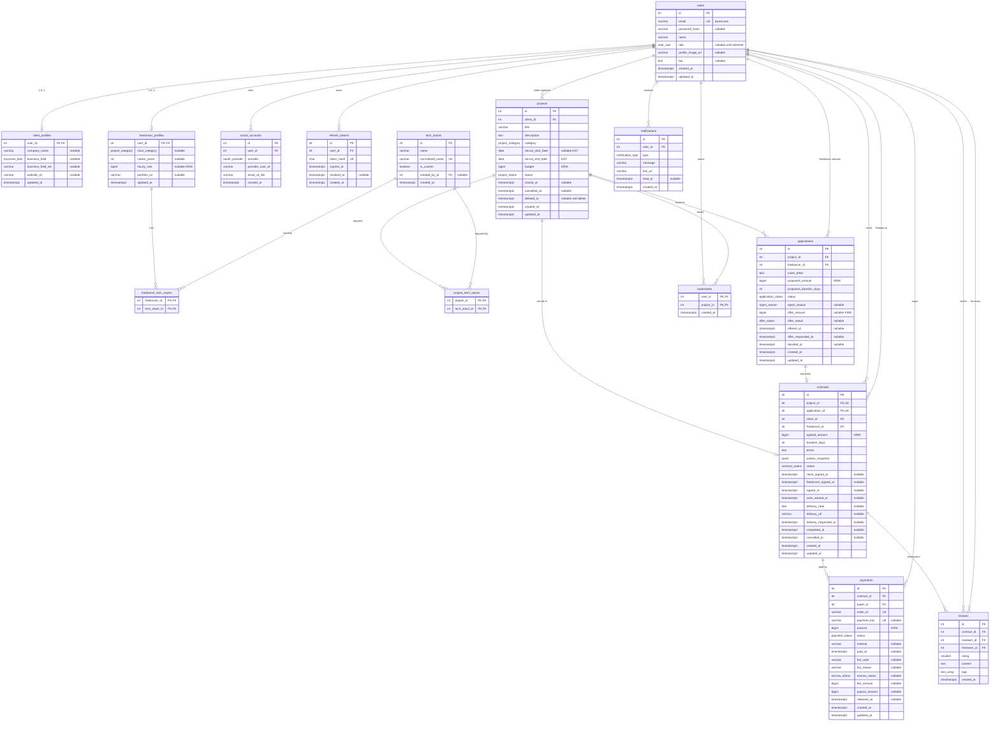

# WorkBridge ERD v1

> 상태: **설계 v1 (DB 미생성, 마이그레이션 없음)**
> 근거: RFP 2부 §3·§4·§7, [DECISIONS.md](./DECISIONS.md)의 확정 항목, [ERD_DRAFT.md](./ERD_DRAFT.md)(초안, 이 문서로 대체)
> DB: PostgreSQL. 타입은 PostgreSQL 기준으로 적고, Prisma 매핑은 §6에 정리한다.
> 고정 기술 스택(D-02)이 확인되지 않았으므로 DB·ORM 선택은 잠정이다.

## 0. 초안 대비 변경 사항 (변경 근거)

| # | 초안(ERD_DRAFT) | v1 | 근거 |
|---|---|---|---|
| 1 | User에 `oauthProvider`, `oauthId` 컬럼 | **SocialAccount 테이블** 분리 | "Google 우선"이므로 두 번째 제공자를 추가할 수 있다. 한 사용자가 여러 소셜 계정을 연동해도 User를 바꾸지 않아도 된다(D-57) |
| 2 | 기술 스택 다대다를 Prisma 암시적 연결로 처리 | **명시적 연결 테이블** ProjectTechStack, FreelancerTechStack | 제출용 ERD에 연결 테이블이 드러나고, 테이블 이름을 팀이 정할 수 있다 |
| 3 | 모집 시작·마감을 `timestamptz`(00:00 / 23:59:59 KST)로 저장 | **`date` 타입**(KST 날짜) | 사용자는 날짜만 입력한다. 시각 변환 실수(UTC 자정 문제)를 없앤다(D-41, D-58) |
| 4 | 프로필 필수 컬럼을 NOT NULL로 가정 | **프로필 컬럼은 nullable**, 완성 여부는 서비스 함수가 판정 | 필수 항목(D-05)이 아직 미확정이다. DB를 바꾸지 않고 판정 함수만 고치면 되게 한다 |
| 5 | `portfolioUrls` 배열 | `portfolioUrl` 단일 값 | RFP 3.1.3은 "포트폴리오 URL"만 요구한다. 단순화 |
| 6 | Notification `isRead` + `readAt` | `readAt`만 사용 (`NULL` = 미확인) | 같은 정보를 두 컬럼에 두면 어긋날 수 있다 |
| 7 | 수락 1건 부분 유니크 인덱스는 "선택" | **필수** | STEP 02 요구: 프로젝트별 수락 대상 1명 제한을 DB가 보장 |
| 8 | 결제 완료 1건 부분 유니크 인덱스는 "선택" | **필수** + 조건부 UPDATE | STEP 02 요구: 결제 성공 중복 처리 방지 |
| 9 | 정산 금액은 서비스 계산만 | 서비스 계산 + **CHECK 제약**(수수료 + 지급액 = 결제액) | 계산 실수를 DB에서 한 번 더 막는다 |
| 10 | Contract 시각 필드 일부 | `workStartedAt`, `cancelledAt` 추가 | 작업 시작일 = 결제 완료일(D-14), 취소 시점 기록 |
| 11 | (v1 최초) 금액 컬럼 `integer` | **`bigint`** (STEP 03-A 변경) | D-51 확정. 대상 8개: `hourly_rate`, `budget`, `proposed_amount`, `offer_amount`, `agreed_amount`, `amount`, `fee_amount`, `payout_amount`. `integer` 최대값(약 21억 원)이 사실상 금액 상한이 되는 문제를 없앤다. 정산 계산은 BigInt로 변경(§5 #7, §6) |

---

## 1. 테이블 목록

| 구분 | 테이블 | 역할 | 선정 근거 |
|---|---|---|---|
| 핵심 | `users` | 계정, 역할, 공통 프로필 | RFP §4 |
| 핵심 | `projects` | 프로젝트 정보, 상태 | RFP §4 |
| 핵심 | `applications` | 지원서 + 금액 제안(1회) | RFP §4, D-11 |
| 핵심 | `contracts` | 계약서, 서명, 납품 | RFP §4 |
| 핵심 | `payments` | 결제 + 에스크로 정산 | RFP §4("결제와 정산 내역"), D-17 |
| 핵심 | `reviews` | 상호 평가 | RFP §4 |
| 핵심 | `notifications` | 인앱 알림 | RFP §4 |
| 핵심 | `bookmarks` | 북마크 | RFP §4 |
| 보조 | `client_profiles` | 의뢰인 전용 프로필 | 역할별 필드를 User에서 분리(D-48) |
| 보조 | `freelancer_profiles` | 프리랜서 전용 프로필 | 역할별 필드를 User에서 분리(D-48) |
| 보조 | `tech_stacks` | 기술 스택 옵션 + 커스텀 | 옵션 선택·커스텀 추가(A-11), 필터(A-21), 추천(A-41)에 공통 사용 |
| 연결 | `project_tech_stacks` | 프로젝트 ↔ 기술 스택 다대다 | 프로젝트 필요 기술(A-15) |
| 연결 | `freelancer_tech_stacks` | 프리랜서 ↔ 기술 스택 다대다 | 프리랜서 보유 기술(A-11) |
| 보조 | `social_accounts` | 소셜 로그인 연동 | Google 우선 + 계정 연동(A-05, A-06, D-57) |
| 보조 | `refresh_tokens` | Refresh Token 저장·무효화 | 재발급·로그아웃 무효화(A-03, A-04, D-26) |

**총 15개** (핵심 8 + 보조 5 + 연결 2). 두지 않는 테이블과 이유는 ERD_DRAFT §1.1과 같다(금액 제안, 정산, 납품, 상태 이력, AI 결과 테이블 없음).

---

## 2. Mermaid ERD

---

## 3. 테이블 정의

표기: **NULL** 열의 `N`은 nullable, `-`는 NOT NULL. 모든 `id`는 `integer GENERATED ALWAYS AS IDENTITY`(자동 증가). 모든 `timestamptz`는 UTC로 저장하고 화면에서 KST로 표시한다(D-41).

### 3.1 users

| 컬럼 | 타입 | NULL | 기본값 | 제약 | 설명 |
|---|---|---|---|---|---|
| id | integer | - | identity | PK | |
| email | varchar(255) | - | | UNIQUE | 저장 전 소문자·공백 제거 정규화 |
| password_hash | varchar(255) | N | | | bcrypt 해시. 소셜로만 가입한 계정은 NULL (N-01) |
| name | varchar(50) | - | | | |
| role | user_role | N | | | `CLIENT`, `FREELANCER`. 소셜 최초 로그인 직후만 NULL (A-07) |
| profile_image_url | varchar(500) | N | | | 스토리지 공개 URL (A-09) |
| bio | text | N | | | 자기소개 |
| created_at | timestamptz | - | now() | | |
| updated_at | timestamptz | - | now() | | |

- 역할은 한 번 정하면 바꾸지 않는다(RFP 3.1.3 "모든 사용자는 두 역할 중 하나"). 역할 변경 API는 없다.

### 3.2 social_accounts

| 컬럼 | 타입 | NULL | 기본값 | 제약 | 설명 |
|---|---|---|---|---|---|
| id | integer | - | identity | PK | |
| user_id | integer | - | | FK → users.id (ON DELETE CASCADE) | |
| provider | oauth_provider | - | | | `GOOGLE` (추가 제공자는 enum 값 추가) |
| provider_user_id | varchar(255) | - | | | Google `sub` |
| email_at_link | varchar(255) | - | | | 연동 시점에 제공자가 **인증 완료**로 확인한 이메일 |
| created_at | timestamptz | - | now() | | |

- UNIQUE `(provider, provider_user_id)`: 같은 Google 계정이 두 사용자에 연결되지 않는다.
- UNIQUE `(user_id, provider)`: 한 사용자는 제공자당 계정 1개만 연동한다.

### 3.3 refresh_tokens

| 컬럼 | 타입 | NULL | 기본값 | 제약 | 설명 |
|---|---|---|---|---|---|
| id | integer | - | identity | PK | |
| user_id | integer | - | | FK → users.id (CASCADE) | |
| token_hash | char(64) | - | | UNIQUE | SHA-256 해시. 원문은 저장하지 않는다 |
| expires_at | timestamptz | - | | | |
| revoked_at | timestamptz | N | | | 재발급(교체)·로그아웃 시 기록 |
| created_at | timestamptz | - | now() | | |

- 인덱스 `(user_id)`. 이미 무효화된 토큰으로 재발급을 시도하면 해당 사용자의 토큰을 모두 무효화한다(탈취 의심).

### 3.4 client_profiles

| 컬럼 | 타입 | NULL | 제약 | 설명 |
|---|---|---|---|---|
| user_id | integer | - | PK, FK → users.id (CASCADE) | 역할이 `CLIENT`인 사용자만 (서비스 검증) |
| company_name | varchar(100) | N | | |
| business_field | business_field | N | | 선택형 |
| business_field_etc | varchar(100) | N | CHECK: `business_field = 'ETC'`일 때만 값 허용 | '기타' 자유 입력 |
| website_url | varchar(500) | N | | |
| updated_at | timestamptz | - | | |

### 3.5 freelancer_profiles

| 컬럼 | 타입 | NULL | 제약 | 설명 |
|---|---|---|---|---|
| user_id | integer | - | PK, FK → users.id (CASCADE) | 역할이 `FREELANCER`인 사용자만 |
| main_category | project_category | N | | 프로젝트 카테고리와 같은 enum 사용(추천 매칭에 활용) |
| career_years | integer | N | CHECK `>= 0` | 경력(년수) |
| hourly_rate | bigint | N | CHECK `> 0` | 시간당 단가(원). 상한 없음(D-42) |
| portfolio_url | varchar(500) | N | | |
| updated_at | timestamptz | - | | |

> 프로필 완성 판정(A-13): DB가 아니라 서비스 함수 `getMissingProfileFields(user)` 하나에서 판단한다. D-05가 확정되면 이 함수만 바꾼다. 추천안 기준 필수 항목은 다음과 같다. 의뢰인: `company_name`, `business_field`(ETC면 `business_field_etc`). 프리랜서: `main_category`, 기술 스택 1개 이상, `career_years`, `hourly_rate`.

### 3.6 tech_stacks, project_tech_stacks, freelancer_tech_stacks

| 테이블 | 컬럼 | 타입 | NULL | 제약 |
|---|---|---|---|---|
| tech_stacks | id | integer | - | PK |
| | name | varchar(50) | - | 표시 이름(예: `React`) |
| | normalized_name | varchar(50) | - | UNIQUE. 소문자 + 공백·점·하이픈 제거(예: `node.js` → `nodejs`) |
| | is_custom | boolean | - | 기본 false. 사용자가 추가한 항목이면 true |
| | created_by_id | integer | N | FK → users.id (ON DELETE SET NULL) |
| | created_at | timestamptz | - | |
| project_tech_stacks | project_id | integer | - | PK(복합), FK → projects.id |
| | tech_stack_id | integer | - | PK(복합), FK → tech_stacks.id, 인덱스 |
| freelancer_tech_stacks | freelancer_id | integer | - | PK(복합), FK → freelancer_profiles.user_id (CASCADE) |
| | tech_stack_id | integer | - | PK(복합), FK → tech_stacks.id, 인덱스 |

- 기본 옵션은 시드로 넣고, 유사 기술은 통합한다(A-12, 예: `SQL`). 커스텀 추가 시 `normalized_name`이 같으면 기존 항목을 재사용한다.

### 3.7 projects

| 컬럼 | 타입 | NULL | 기본값 | 제약 | 설명 |
|---|---|---|---|---|---|
| id | integer | - | identity | PK | |
| client_id | integer | - | | FK → users.id (RESTRICT) | 등록한 의뢰인 |
| title | varchar(100) | - | | | |
| description | text | - | | | 키워드 검색 대상 |
| category | project_category | - | | | |
| recruit_start_date | date | N | | | KST 날짜. NULL이면 등록 즉시 모집 중 (A-24) |
| recruit_end_date | date | - | | CHECK `recruit_start_date IS NULL OR recruit_start_date <= recruit_end_date` | KST 날짜. 그날 23:59:59까지 모집 |
| budget | bigint | - | | CHECK `> 0` | 원. 상한 없음(D-42) |
| status | project_status | - | | | 7개 상태(D-03) |
| closed_at | timestamptz | N | | | 모집 마감 시각(자동·수동·수락) |
| cancelled_at | timestamptz | N | | | |
| deleted_at | timestamptz | N | | | 소프트 삭제(A-17, D-53) |
| created_at | timestamptz | - | now() | | |
| updated_at | timestamptz | - | now() | | |

인덱스:
- `(status, recruit_end_date) WHERE deleted_at IS NULL`: 목록 상태 필터, 마감임박순, 자동 마감 대상
- `(status, recruit_start_date) WHERE deleted_at IS NULL`: 자동 모집 시작 대상
- `(category)`, `(created_at DESC)`, `(budget DESC)`: 필터·정렬
- `(client_id, created_at DESC)`: 내 프로젝트
- 키워드 검색은 `ILIKE '%키워드%'`(제목·설명)로 시작한다. 느려지면 `pg_trgm` 인덱스를 검토한다.

### 3.8 applications

| 컬럼 | 타입 | NULL | 기본값 | 제약 | 설명 |
|---|---|---|---|---|---|
| id | integer | - | identity | PK | |
| project_id | integer | - | | FK → projects.id (RESTRICT) | |
| freelancer_id | integer | - | | FK → users.id (RESTRICT) | |
| cover_letter | text | - | | | 자기소개 |
| proposed_amount | bigint | - | | CHECK `> 0` | 예상 단가(원) |
| proposed_duration_days | integer | - | | CHECK `> 0` | 예상 기간(일, D-46) |
| status | application_status | - | `PENDING` | | `PENDING`(검토중), `ACCEPTED`(수락), `REJECTED`(거절) |
| reject_reason | reject_reason | N | | CHECK: `status = 'REJECTED'`일 때만 값 | 직접·자동·마감·결렬·취소 구분(D-49) |
| offer_amount | bigint | N | | CHECK `> 0` | 의뢰인이 수락 시 제시한 합의 금액(D-11) |
| offer_status | offer_status | N | | | `PENDING`, `AGREED`, `DECLINED` |
| offered_at | timestamptz | N | | | |
| offer_responded_at | timestamptz | N | | | |
| decided_at | timestamptz | N | | | 수락·거절 시각 |
| created_at, updated_at | timestamptz | - | now() | | |

제약·인덱스:
- **UNIQUE `(project_id, freelancer_id)`**: 동일 프로젝트 중복 지원 방지(A-29)
- **부분 UNIQUE `(project_id) WHERE status = 'ACCEPTED'`**: 프로젝트당 수락 1명(A-33). 금액 결렬 시 수락 지원이 `REJECTED`로 바뀌므로 다음 수락이 가능하다
- CHECK `status <> 'ACCEPTED' OR (offer_amount IS NOT NULL AND offer_status IS NOT NULL)`: 수락에는 반드시 제안 금액이 있다
- 인덱스 `(project_id, status)`: 지원 관리, 일괄 거절 대상 조회
- 인덱스 `(freelancer_id, created_at DESC)`: 내 지원 현황

### 3.9 contracts

| 컬럼 | 타입 | NULL | 제약 | 설명 |
|---|---|---|---|---|
| id | integer | - | PK | |
| project_id | integer | - | FK → projects.id, **UNIQUE** | 프로젝트당 계약 1건 |
| application_id | integer | - | FK → applications.id, **UNIQUE** | |
| client_id | integer | - | FK → users.id | 조회 권한 판단용(중복이지만 조회가 단순해짐) |
| freelancer_id | integer | - | FK → users.id | |
| agreed_amount | bigint | - | CHECK `> 0` | 서버가 `applications.offer_amount`에서 복사(B-06) |
| duration_days | integer | - | CHECK `> 0` | 지원서의 예상 기간에서 복사(D-14) |
| terms | text | - | | 자동 생성 계약 본문 |
| parties_snapshot | jsonb | - | | 생성 시점의 양측 이름·이메일·회사명(D-15) |
| status | contract_status | - | | 기본 `SIGNATURE_PENDING` |
| client_signed_at | timestamptz | N | | |
| freelancer_signed_at | timestamptz | N | | |
| signed_at | timestamptz | N | | 양측 서명 완료 = **계약 체결**(D-13) |
| work_started_at | timestamptz | N | | 결제 승인 시각(D-14) |
| delivery_note | text | N | | 납품 메모 |
| delivery_url | varchar(500) | N | | 납품물 링크 |
| delivery_requested_at | timestamptz | N | | |
| completed_at | timestamptz | N | | 완료 승인 시각 |
| cancelled_at | timestamptz | N | | 체결 전 취소 시각 |
| created_at, updated_at | timestamptz | - | | |

- CHECK `client_id <> freelancer_id`
- CHECK `signed_at IS NULL OR (client_signed_at IS NOT NULL AND freelancer_signed_at IS NOT NULL)`
- 인덱스 `(client_id, created_at DESC)`, `(freelancer_id, created_at DESC)`: 내 계약 목록

### 3.10 payments

| 컬럼 | 타입 | NULL | 제약 | 설명 |
|---|---|---|---|---|
| id | integer | - | PK | |
| contract_id | integer | - | FK → contracts.id | |
| payer_id | integer | - | FK → users.id | 계약의 의뢰인 |
| order_id | varchar(64) | - | **UNIQUE** | 서버 생성 주문 번호(예: `wb_` + 랜덤) |
| payment_key | varchar(200) | N | **UNIQUE** | PG 발급 결제 키(승인 후) |
| amount | bigint | - | CHECK `> 0` | 서버가 `contracts.agreed_amount`로 결정 |
| status | payment_status | - | | `READY`, `PAID`, `FAILED`, `REFUNDED` |
| method | varchar(30) | N | | PG 응답의 결제 수단 |
| paid_at | timestamptz | N | | |
| fail_code, fail_reason | varchar | N | | 실패 기록 |
| escrow_status | escrow_status | N | | `HELD`(보관), `RELEASED`(지급 처리) |
| fee_amount | bigint | N | CHECK `>= 0` | 수수료(10%) |
| payout_amount | bigint | N | CHECK `>= 0` | 프리랜서 지급액 |
| released_at | timestamptz | N | | 모의 지급 처리 시각 |
| created_at, updated_at | timestamptz | - | | |

- **부분 UNIQUE `(contract_id) WHERE status = 'PAID'`**: 계약당 결제 성공 1건(B-09)
- CHECK `status <> 'PAID' OR (payment_key IS NOT NULL AND paid_at IS NOT NULL AND escrow_status IS NOT NULL)`
- CHECK `escrow_status <> 'RELEASED' OR (fee_amount + payout_amount = amount)`: 정산 합계 검증(B-14)
- 인덱스 `(payer_id, created_at DESC)`: 결제 내역, `(contract_id)`

### 3.11 reviews

| 컬럼 | 타입 | NULL | 제약 | 설명 |
|---|---|---|---|---|
| id | integer | - | PK | |
| contract_id | integer | - | FK → contracts.id | |
| reviewer_id | integer | - | FK → users.id | 작성자 |
| reviewee_id | integer | - | FK → users.id | 대상. **서버가 계약의 상대방으로 결정** |
| rating | smallint | - | CHECK `BETWEEN 1 AND 5` | |
| content | text | - | | |
| tags | text[] | - | 기본 `{}` | 역할별 태그 목록(D-20)에 있는 값만 허용(서비스 검증) |
| created_at | timestamptz | - | | `updated_at` 없음 = 수정 불가(B-18) |

- **UNIQUE `(contract_id, reviewer_id)`**: 작성자별 1회(B-18)
- CHECK `reviewer_id <> reviewee_id`
- 인덱스 `(reviewee_id, created_at DESC)`: 공개 프로필 리뷰 목록·평균 별점(B-19)

### 3.12 notifications

| 컬럼 | 타입 | NULL | 제약 | 설명 |
|---|---|---|---|---|
| id | integer | - | PK | |
| user_id | integer | - | FK → users.id (CASCADE) | 수신자 |
| type | notification_type | - | | 필수 5종(+ C-01 착수 시 추가) |
| message | varchar(255) | - | | 표시 문구 |
| link_url | varchar(255) | - | | 클릭 시 이동할 FE 경로(D-36) |
| read_at | timestamptz | N | | NULL이면 미확인 |
| created_at | timestamptz | - | | |

- 인덱스 `(user_id, created_at DESC)`: 알림 목록
- 부분 인덱스 `(user_id) WHERE read_at IS NULL`: 헤더 미확인 수(A-37)

### 3.13 bookmarks

| 컬럼 | 타입 | NULL | 제약 |
|---|---|---|---|
| user_id | integer | - | PK(복합), FK → users.id (CASCADE) |
| project_id | integer | - | PK(복합), FK → projects.id, 인덱스 |
| created_at | timestamptz | - | |

- 복합 PK가 중복 북마크를 막는다(A-39). 삭제된 프로젝트는 목록에서 제외한다.

---

## 4. enum 정의

| enum | 값 | 상태 |
|---|---|---|
| user_role | `CLIENT`, `FREELANCER` | 확정(RFP) |
| oauth_provider | `GOOGLE` | 확정(D-23) |
| project_status | `SCHEDULED`, `RECRUITING`, `CLOSED`, `CONTRACTING`, `IN_PROGRESS`, `COMPLETED`, `CANCELLED` | 확정(D-03) |
| application_status | `PENDING`, `ACCEPTED`, `REJECTED` | 확정(RFP 3.2.4) |
| reject_reason | `MANUAL`, `OTHER_ACCEPTED`, `PROJECT_CLOSED`, `NEGOTIATION_FAILED`, `PROJECT_CANCELLED`, `PROJECT_DELETED` | 제안(D-49) |
| offer_status | `PENDING`, `AGREED`, `DECLINED` | 확정(D-11) |
| contract_status | `SIGNATURE_PENDING`, `SIGNED`(= 결제 대기), `IN_PROGRESS`, `DELIVERY_REQUESTED`, `COMPLETED`, `CANCELLED` | 확정(D-04) |
| payment_status | `READY`, `PAID`, `FAILED`, `REFUNDED` | 확정(D-04, D-17) |
| escrow_status | `HELD`, `RELEASED` | 제안(D-17) |
| notification_type | `APPLICATION_SUBMITTED`, `APPLICATION_ACCEPTED`, `APPLICATION_AUTO_REJECTED`, `APPLICATION_REJECTED`, `PROJECT_CLOSED` | 확정(RFP 3.3.1) |
| project_category | `WEB`, `MOBILE`, `DESIGN`, `MARKETING`, `DATA_AI`, `PLANNING`, `ETC` | **제안(D-59)** |
| business_field | `IT`, `COMMERCE`, `EDUCATION`, `FINANCE`, `HEALTHCARE`, `MEDIA`, `MANUFACTURING`, `ETC` | **제안(D-59)** |

---

## 5. 무결성 검토 (STEP 02 요구 7가지)

| # | 조건 | DB 보장 | 서버 보장 | 테스트 |
|---|---|---|---|---|
| 1 | 동일 프로젝트 중복 지원 방지 | UNIQUE `applications(project_id, freelancer_id)` | 지원 전 조회 → 409 `ALREADY_APPLIED`. 동시 요청은 UNIQUE 위반(P2002)을 409로 변환 | 같은 요청 2회·동시 2회 → 1건만 생성 |
| 2 | 프로젝트별 수락 대상 1명 | 부분 UNIQUE `applications(project_id) WHERE status='ACCEPTED'` | 수락 트랜잭션 첫 단계에서 프로젝트 행 잠금(`SELECT … FOR UPDATE`) → `status = RECRUITING` 확인 | 서로 다른 지원 2건 동시 수락 → 1건 성공, 1건 409 |
| 3 | 자동 거절과 알림 생성의 원자성 | 하나의 트랜잭션 | 수락 트랜잭션 안에서 ① 대상 `ACCEPTED` ② 나머지 `PENDING` → `REJECTED(OTHER_ACCEPTED)` ③ 프로젝트 `CONTRACTING` ④ 알림 ②·③ `createMany`. 어느 단계든 실패하면 전체 롤백 | 알림 생성 단계에서 강제 실패 → 상태도 바뀌지 않음 |
| 4 | 리뷰 작성자별 중복 방지 | UNIQUE `reviews(contract_id, reviewer_id)` | 계약 `COMPLETED` 확인, 대상은 서버가 결정, 수정·삭제 API 없음 | 같은 작성자 2회·동시 2회 → 1건 |
| 5 | 계약 체결 전후 수정 권한 | 계약 본문 컬럼을 바꾸는 API 자체가 없음 | 아래 §5.1 표 | 상태별 수정 시도 → 409 |
| 6 | 결제 성공 중복 처리 방지 | UNIQUE `order_id`, UNIQUE `payment_key`, 부분 UNIQUE `(contract_id) WHERE status='PAID'` | 승인 반영은 조건부 UPDATE `WHERE id = ? AND status = 'READY'`. 영향 행 0이면 이미 처리된 것으로 보고 기존 결과를 반환(멱등) | 같은 승인 요청 2회 → 상태 변경 1회, 두 번째는 같은 응답 |
| 7 | 정산 금액과 수수료 10% | CHECK `fee_amount + payout_amount = amount` | `fee = amount / 10n`(BigInt 나눗셈은 소수점 이하를 버림 = floor), `payout = amount - fee`(D-18). Number로 변환하지 않고 BigInt로만 계산(D-51) | 경계값: 1원, 9원, 10원, 15원, 999,999원 |

### 5.1 상태별 수정 권한 (계약 체결 전후)

| 대상 | 수정 가능 시점 | 수정 불가 시점 | 근거 |
|---|---|---|---|
| 프로젝트 일반 필드(제목, 설명, 카테고리, 기술 스택) | `SCHEDULED`, `RECRUITING`, `CLOSED` | `CONTRACTING` 이후 | 거래가 시작되면 계약 근거가 바뀌면 안 됨(D-55, 제안) |
| 프로젝트 예산·마감일 | 위 상태 + 대기·수락 지원이 없을 때 | 지원자가 있을 때, `CONTRACTING` 이후 | RFP 3.2.1, D-06(제안) |
| 지원서 내용 | 수정 기능 없음 | - | RFP에 수정 요구 없음(D-35 철회도 제외) |
| 제안 금액 | 수락 시 1회 입력 | 이후 변경 불가 | D-11 |
| 계약 본문·금액·기간·당사자 | 없음(자동 생성) | 항상 | B-06, D-15 |
| 서명 | 각 당사자 1회 | 서명 후 철회 불가 | B-07 |
| 계약 취소 | `SIGNATURE_PENDING`(체결 전, 의뢰인이 프로젝트 취소 시) | `SIGNED` 이후(체결 후) | RFP 2.3, D-13 |
| 납품 정보 | `IN_PROGRESS`에서 납품 요청 시 1회 | 요청 후 | D-19(제안) |

### 5.2 프로젝트 상태 전환 규칙 (서버 검증, D-52)

모든 상태 변경은 서비스 계층의 전환표 한 곳에서 검사한다. 표에 없는 전환은 409 `INVALID_STATE_TRANSITION`.

| 현재 → 다음 | 트리거 | 주체 | 함께 바뀌는 것 |
|---|---|---|---|
| (신규) → `SCHEDULED` | 등록, 시작일 > 오늘(KST) | 의뢰인 | - |
| (신규) → `RECRUITING` | 등록, 시작일 없음 또는 오늘 | 의뢰인 | - |
| `SCHEDULED` → `RECRUITING` | 시작일 도래 | 시스템 | - |
| `RECRUITING` → `CLOSED` | 마감일 경과 / 수동 마감 | 시스템 / 의뢰인 | 대기 지원 일괄 `REJECTED(PROJECT_CLOSED)` + 알림 ⑤ |
| `RECRUITING` → `CONTRACTING` | 지원자 수락(+ 제안 금액) | 의뢰인 | 자동 거절 + 알림 ②③ |
| `CONTRACTING` → `RECRUITING` / `CLOSED` | 프리랜서 금액 거부(마감일 전 / 후) | 프리랜서 | 지원 `REJECTED(NEGOTIATION_FAILED)` (D-10, 제안) |
| `CONTRACTING` → `IN_PROGRESS` | 결제 승인(계약 `SIGNED` 상태일 때만) | 시스템(PG 검증) | 계약 `IN_PROGRESS`, 결제 `PAID`·`HELD` |
| `IN_PROGRESS` → `COMPLETED` | 완료 승인(계약 `DELIVERY_REQUESTED`일 때만) | 의뢰인 | 계약 `COMPLETED`, 결제 `RELEASED` + 수수료·지급액 |
| `SCHEDULED`/`RECRUITING`/`CLOSED`/`CONTRACTING` → `CANCELLED` | 의뢰인 취소, 단 계약이 체결 전(`SIGNED` 아님)일 때만 | 의뢰인 | 대기 지원 `REJECTED(PROJECT_CANCELLED)`, 서명 전 계약 `CANCELLED` |

- 날짜 판단은 `오늘(KST) = (now() AT TIME ZONE 'Asia/Seoul')::date`로 한다. 마감일 당일은 모집 중이고, 다음 날 0시(KST)부터 마감 대상이다.
- 자동 전환은 cron + 조회 시 보정(D-08, 제안)으로 실행하며, 같은 전환을 두 번 실행해도 결과가 같아야 한다(조건부 UPDATE).

---

## 6. Prisma 매핑 메모 (구현 시 참고)

| 항목 | 방법 |
|---|---|
| 테이블·컬럼 이름 | 모델은 PascalCase, 필드는 camelCase, `@@map("snake_case")`·`@map`으로 DB 이름 지정 |
| `date` 컬럼 | `DateTime @db.Date`. 서버에서는 `'YYYY-MM-DD'` 문자열로 주고받고 KST 오늘 날짜 문자열과 비교 |
| `timestamptz` | `DateTime @db.Timestamptz(3)` |
| 부분 UNIQUE·CHECK 제약 | Prisma 스키마로 표현이 어려운 항목은 마이그레이션 SQL에 직접 추가(설정 단계에서 Prisma 버전의 지원 여부를 확인) |
| 행 잠금 | `$transaction` 안에서 `$queryRaw\`SELECT … FOR UPDATE\`` |
| 금액 | `BigInt`(PostgreSQL `bigint`, D-51). Prisma는 JS `BigInt`로 돌려주므로 `JSON.stringify`가 그대로는 실패한다. 응답 직렬화 시 금액을 **10진수 문자열**로 바꾸고, 요청의 금액 문자열(또는 안전 정수)을 `BigInt`로 바꾸는 변환 함수를 한 곳에 둔다. 계산은 `BigInt`끼리만 한다 |
