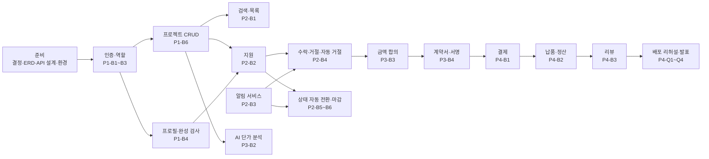

# WorkBridge 개발 일정 (22일 · 198시간)

> 근거: RFP 1부 '프로젝트 개발 일정'(총 22일, 198시간, 4 페이즈, 페이즈는 5일 단위, 페이즈 종료 시 계획서·칸반·회고록), 2부 §8 수용 기준
> 요구사항 ID는 [REQUIREMENTS.md](./REQUIREMENTS.md)(`A-` 기본 필수, `B-` 심화 필수, `C-` 도전), 결정 항목은 [DECISIONS.md](./DECISIONS.md)를 따른다.

## 0. 전제

### 0.1 전체 구성

| 구간 | 기간 | 시간(1인 기준) | 범위 | 종료 기준 |
|---|---|---|---|---|
| 준비 | Day 1–2 | 18h | 요구사항, ERD, API 설계, 개발 환경 | 착수 전 결정 확정, ERD v1, API 설계 v1, 저장소·DB 기동 |
| 페이즈 1 | Day 3–7 | 45h | 인증, 사용자(프로필), 프로젝트 관리 | §2.3 |
| 페이즈 2 | Day 8–12 | 45h | 검색, 지원, 알림, 북마크 (+ 상태 전환, 추천) | RFP 8.1 전체 |
| 페이즈 3 | Day 13–17 | 45h | AI 단가 분석, 금액 합의, 계약 | RFP 8.2 중 AI·계약 항목 |
| 페이즈 4 | Day 18–22 | 45h | 결제, 정산, 리뷰, 배포 및 발표 | RFP 8.2 전체 + 제출 전 점검 |

- 198시간 ÷ 22일 = 하루 약 9시간. 페이즈 하나는 약 45시간이다. 이 중 **약 3시간은 페이즈 의식**(계획서, 칸반 정리, 회고)에 쓴다고 보고 작업량을 잡았다.
- 인원은 아직 정해지지 않았다(D-02 확인 시 함께 정함). 작업은 FE/BE로 나눠 적었다. 1~2인이면 **BE를 먼저 끝내고 FE가 따라가는 순서**를 지키고, 화면 다듬기 범위를 줄인다.

### 0.2 페이즈 의식 (RFP 1부: 매 페이즈 종료 시)

| 시점 | 할 일 | 산출물 위치 |
|---|---|---|
| 페이즈 첫날 오전 | 페이즈 계획서 작성: 목표, 작업 목록(이 문서의 ID), 담당, 완료 조건 | 워크스페이스(Notion 또는 GitHub Projects) |
| 매일 | 칸반 보드 갱신(할 일 → 진행 중 → 리뷰 → 완료), 막힌 일 공유 | 칸반 보드 |
| 페이즈 마지막 날 오후 | 배포 URL에서 완료 조건 체크, 회고록 작성(잘된 점, 문제, 다음 페이즈에서 바꿀 점), 결정 기록 정리 | 워크스페이스 |

회고록은 페이즈마다 1회씩 총 4회를 쓴다(제출 기준은 최소 2회).

### 0.3 우선순위 원칙

1. A(기본 필수) → B(심화 필수) 순서로만 진행한다. C(도전)는 RFP 8.2 체크리스트를 모두 통과한 뒤에만 착수한다.
2. 배포 골격을 페이즈 1에 만든다. 페이즈마다 배포 URL에서 종료 기준을 확인한다.
3. 부수 효과가 있는 규칙(자동 거절, 일괄 마감, 결제 검증, 정산, 리뷰 1회)은 자동 테스트로 고정한다.
4. 일정이 밀리면 화면 꾸밈, 부가 정보, 선택 항목을 줄인다. 필수 요구사항은 줄이지 않는다(§6).

### 0.4 테스트 방법 (모든 페이즈 공통)

| 종류 | 도구 | 대상 |
|---|---|---|
| 단위 테스트 | Vitest | 순수 규칙: 프로필 완성 판정, 상태 계산, 수수료 계산, 평균 별점 |
| API 통합 테스트 | Vitest + Supertest + 테스트용 DB | 권한, 트랜잭션 규칙(자동 거절, 결제 승인, 정산), 중복 방지 |
| 외부 연동 | mock 어댑터 | OAuth·LLM·PG·스토리지. 실제 키 없이 CI에서 전체 흐름 실행 |
| 수동 시나리오 | 체크리스트 + 두 계정(의뢰인·프리랜서) | 페이즈 종료 시 배포 URL에서 완료 조건 확인 |
| 반응형 확인 | 브라우저 개발자 도구 | 360px, 1280px 두 폭에서 주요 화면(D-50) |

### 0.5 작업 ID

`P{페이즈}-{영역}{번호}`. 영역은 `C` 공통·인프라, `B` 백엔드, `F` 프론트엔드, `Q` 품질·문서. **선행** 열은 그 작업을 시작하기 전에 끝나 있어야 하는 작업이나 결정이다.

---

## 1. 준비 (Day 1–2): 요구사항 · ERD · API 설계 · 개발 환경

| ID | 작업 | 선행 | 완료 조건 |
|---|---|---|---|
| P0-Q1 | 요구사항 리뷰: ID·수용 기준 확정 | - | REQUIREMENTS.md 팀 리뷰 완료 |
| P0-Q2 | 착수 전 결정 회의(DECISIONS.md §1의 항목) | P0-Q1 | 해당 항목 상태를 '확정'으로 바꾸고 근거 기록 |
| P0-Q3 | ERD v1 확정 → dbdiagram.io로 옮김 | P0-Q2 (D-03, D-04, D-48) | 공유 링크, 팀 승인 |
| P0-Q4 | **API 설계 v1**: 엔드포인트 목록(경로, 메서드, 권한, 요청·응답 요약, 에러 형식) | P0-Q1, P0-Q3 | Swagger 또는 Postman에 페이즈 1·2 엔드포인트 등록 |
| P0-Q5 | 협업 규칙(브랜치 전략, 커밋 컨벤션, PR 템플릿), 칸반 보드, 페이즈 1 계획서 | P0-Q2 (D-44) | 워크스페이스 한 곳에 정리 |
| P0-C1 | 개발 환경: 원격 저장소 생성, 초기 커밋, 모노레포 골격(`apps/web`, `apps/api`), ESLint/Prettier, `.gitignore`, `.env.example` | D-02 | 팀원 전원 로컬에서 FE·BE 기동. `.env`는 커밋되지 않음 |
| P0-C2 | 로컬·개발 DB 세팅, Prisma 초기 스키마(User, 프로필, TechStack, RefreshToken, Project)와 첫 마이그레이션 | P0-Q3, P0-C1 | `prisma migrate` 성공 |

**산출물:** REQUIREMENTS / USER_FLOWS / ERD / DECISIONS(확정본), ERD v1 링크, API 설계 v1, 칸반 보드, 페이즈 1 계획서

---

## 2. 페이즈 1 (Day 3–7): 인증 · 사용자 · 프로젝트 관리

**목표:** 이메일·소셜로 가입·로그인하고, 역할별 프로필을 채우고, 의뢰인이 프로젝트를 등록·수정·삭제·상세 조회할 수 있다.

**선행 조건:** 준비 단계 완료. 특히 D-05(필수 프로필 항목), D-06(수정 제한), D-07(삭제 조건), D-23·D-24(소셜 제공자·연동 조건), D-25(토큰 보관), D-41(날짜 기준 시각) 확정.

### 2.1 구현 범위

| ID | 작업 | 담당 | 선행 | 요구사항 |
|---|---|---|---|---|
| P1-C1 | CI(GitHub Actions: lint, test) | 공통 | P0-C1 | N-11 |
| P1-C2 | 배포 골격: FE Vercel, BE Render, DB, `/api/health`, `/api` rewrite | 공통 | P0-C1 | N-07 |
| P1-B1 | 공통 미들웨어: 에러 응답 형식, 입력 검증, 인증, 역할 검사, 프로필 완성 검사 | BE | P0-C2 | A-08, A-13 |
| P1-B2 | 이메일 회원가입·로그인·토큰 재발급·로그아웃·내 정보 | BE | P1-B1 | A-01~A-04, N-01 |
| P1-B3 | 소셜 로그인 1종 + 동일 이메일 연동 + 역할 선택 API | BE | P1-B2, D-23, D-24 | A-05~A-07 |
| P1-B4 | 프로필 API(공통, 의뢰인, 프리랜서, 공개) + 기술 스택 옵션 시드·검색·커스텀 추가 | BE | P1-B1 | A-09~A-12, A-14 |
| P1-B5 | 이미지 업로드(스토리지 어댑터, mock 포함) | BE | P1-B4, D-29 | A-09 |
| P1-B6 | 프로젝트 등록(시작일 기준 초기 상태), 수정(소유자 검사, 지원자 있을 때 제한), 소프트 삭제, 상세, 내 프로젝트 | BE | P1-B1 | A-15~A-18, A-24(등록 시점), A-28 |
| P1-F1 | 앱 골격: 라우터, 로그인 상태별 헤더, API 클라이언트(401 → 재발급 → 재시도), 새로고침 시 세션 복원, 반응형 레이아웃 기본 | FE | P0-C1 | A-03, A-42, N-14 |
| P1-F2 | 회원가입·로그인·소셜 콜백·역할 선택 화면 | FE | P1-F1, P1-B2 | A-01, A-02, A-05, A-07 |
| P1-F3 | 내 프로필(역할별 폼, 기술 스택 자동완성 + 커스텀, 이미지 업로드, `returnTo` 복귀), 공개 프로필 기본 | FE | P1-F1, P1-B4 | A-09~A-11, A-13, A-14 |
| P1-F4 | 프로젝트 등록 3단계 퍼널, 수정, 상세(기본), 내 프로젝트(기본) | FE | P1-F1, P1-B6 | A-15, A-16, A-18, A-28 |

### 2.2 테스트 방법

- 인증: 가입 시 해시 저장(평문 없음), 중복 이메일 거부, 로그인 실패, 토큰 재발급, 로그아웃 후 재발급 거부
- 소셜: 신규 생성 / 기존 소셜 계정 로그인 / 같은 이메일 연동 (제공자 응답은 mock)
- 권한: 프리랜서의 프로젝트 등록 거부, 남의 프로젝트 수정·삭제 거부
- 프로젝트: 시작일에 따른 초기 상태, 소프트 삭제 후 상세 제외, 지원자 있을 때 예산·마감일 제한(D-06 기준. 지원 기능 전이므로 테스트 데이터로 지원 행을 직접 만듦)
- 프로필 완성 판정(D-05 기준) 단위 테스트
- 수동: 배포 URL에서 의뢰인 계정으로 가입 → 프로필 유도 → 등록 → 수정 → 삭제

### 2.3 완료 조건

- [ ] 이메일 가입·로그인·로그아웃이 동작하고, 새로고침해도 로그인이 유지된다
- [ ] 소셜 로그인으로 신규 가입 시 역할 선택으로 이동하고, 같은 이메일의 기존 계정은 연동된다
- [ ] 프로필이 비어 있는 의뢰인이 '프로젝트 등록'을 누르면 프로필 입력 후 등록 화면으로 돌아온다
- [ ] 의뢰인이 프로젝트를 등록(3단계), 수정, 삭제(소프트), 상세 조회할 수 있다
- [ ] 배포 URL의 `/api/health`가 응답하고, `main` 머지 시 자동 배포된다
- [ ] 페이즈 1 회고록·칸반 갱신 완료

**산출물:** API 명세(인증·사용자·프로젝트), 배포 URL(골격), 회고록 #1

---

## 3. 페이즈 2 (Day 8–12): 검색 · 지원 · 알림 · 북마크

**목표:** 회원가입부터 프로젝트 지원, 수락·자동 거절, 알림 수신까지 A(기본 필수) 전체 흐름이 배포 환경에서 동작한다(RFP 8.1).

**선행 조건:** 페이즈 1 완료(인증, 프로필 완성 검사, 프로젝트 CRUD). D-08(자동 전환 방식), D-30(추천 기준), D-31(북마크 대상), D-32(마감일 필터), D-34(지원·수락 가능 상태), D-36(알림 이동), D-37(알림 갱신), D-40(페이지네이션) 확정.

### 3.1 구현 범위

| ID | 작업 | 담당 | 선행 | 요구사항 |
|---|---|---|---|---|
| P2-B1 | 프로젝트 목록 API: 키워드, 필터 5종, 정렬 3종, 페이지당 10개, 외부 노출 상태 매핑 | BE | P1-B6 | A-20~A-23, A-26 |
| P2-B2 | 지원 API(중복 방지, 지원 가능 상태 검사), 지원자 목록, 내 지원 현황 | BE | P1-B6 | A-29, A-31, A-35 |
| P2-B3 | 알림 서비스: 생성 함수(이벤트와 같은 트랜잭션), 목록, 미확인 수, 단건·일괄 읽음 | BE | P1-B1 | A-36~A-38 |
| P2-B4 | 수락(트랜잭션: 자동 거절 + 프로젝트 계약 대기 + 알림 ②③), 직접 거절(알림 ④), 지원 시 알림 ① | BE | P2-B2, P2-B3 | A-25, A-32, A-33 |
| P2-B5 | 상태 자동 전환: 시작일 도래 → 모집 중, 마감일 초과 → 마감 + 미처리 지원 일괄 거절 (cron + 조회 시 동기화) | BE | P2-B2, P2-B3 | A-24, A-34 |
| P2-B6 | 수동 마감(알림 ⑤), 프로젝트 취소 | BE | P2-B5 | A-24, A-27 |
| P2-B7 | 북마크, 추천 프로젝트 | BE | P1-B6 | A-39~A-41 |
| P2-B8 | 시드 데이터 v1(의뢰인·프리랜서 계정, 상태별 프로젝트, 지원) | BE | P2-B2 | N-08 |
| P2-F1 | 홈(검색창, 카테고리 버튼, 최신 프로젝트), 목록(필터·정렬·페이지, URL 쿼리 동기화, 모바일 접이식 필터) | FE | P2-B1 | A-19~A-23 |
| P2-F2 | 상세 보강: 지원자 수, 상태, 북마크, 추천, 소유자용 마감·취소 버튼 | FE | P2-B6, P2-B7 | A-18, A-39, A-41 |
| P2-F3 | 지원서 작성(프로필 유도·복귀) → 제출 후 내 지원 현황 자동 이동 | FE | P2-B2 | A-13, A-29, A-30 |
| P2-F4 | 지원 관리(의뢰인): 지원자 목록, 지원서, 공개 프로필 링크, 수락·거절(확인 모달) | FE | P2-B4 | A-31, A-32 |
| P2-F5 | 내 지원 현황, 내 프로젝트(상태 보강), 내 북마크 | FE | P2-B2, P2-B7 | A-28, A-35, A-40 |
| P2-F6 | 헤더 알림 배지(주기 갱신), 알림 목록(클릭 시 읽음 + 이동, 일괄 읽음) | FE | P2-B3 | A-37, A-38 |

> 수락 시 합의 금액 입력(B-04)은 페이즈 3 범위다. 페이즈 2의 수락은 상태 전환·자동 거절·알림까지만 만들고, 페이즈 3에서 금액 입력을 붙인다.

### 3.2 테스트 방법

- 목록: 필터·정렬 조합, 페이지 경계, 거래 단계 프로젝트가 '모집 마감'으로 노출, 삭제·취소 제외
- 상태 전환(시계를 고정한 테스트): 시작일 도래, 마감일 초과 → 일괄 거절 + 알림, 두 번 실행해도 결과 동일
- 지원: 중복 지원 거부, 모집 중이 아닌 프로젝트 지원 거부
- 수락: 3명 지원 중 1명 수락 → 2명 자동 거절 + 알림 3건, 동시에 두 명 수락 시 1건만 성공
- 마감: 수동 마감 시 미처리 지원 일괄 거절 + 지원자 전원 알림
- 알림: 수신자·링크 정확성, 상태 변경 실패 시 알림도 생성되지 않음, 읽음·일괄 읽음
- 수동: 배포 URL에서 의뢰인 1 + 프리랜서 3 계정으로 지원 → 수락 → 자동 거절 알림 확인

### 3.3 완료 조건 (= RFP 8.1, 배포 URL에서 확인)

- [ ] 이메일 및 소셜 로그인 모두 정상 동작
- [ ] 의뢰인 역할로 프로젝트 등록, 수정, 삭제, 상세 조회 가능
- [ ] 프리랜서 역할로 프로젝트 검색, 필터, 지원 가능
- [ ] 의뢰인의 지원 수락 시 타 지원 일괄 자동 거절 및 양측 알림 동작
- [ ] 프로젝트 상태가 시간 경과(모집 시작일과 마감일) 및 의뢰인 액션에 따라 올바르게 전환
- [ ] 5가지 알림 트리거가 정상 작동하고 헤더 미확인 표시가 노출
- [ ] 회원가입부터 프로젝트 지원, 알림 수신까지의 전체 플로우가 동작
- [ ] 페이즈 2 회고록·칸반 갱신 완료

**산출물:** API 명세 v1, ERD 갱신, 배포 URL 1차, 시연 계정, 회고록 #2

---

## 4. 페이즈 3 (Day 13–17): AI 단가 분석 · 금액 합의 · 계약

**목표:** 의뢰인이 AI로 예산을 잡고, 지원자 수락 후 금액 합의 → 계약서 자동 생성 → 양측 서명까지 진행할 수 있다.

**선행 조건:** 페이즈 2의 수락 트랜잭션(P2-B4) 완료. D-11·D-12(합의 흐름), D-10(결렬 후 상태), D-13(계약 체결 시점), D-14·D-15(계약서 기간·당사자 정보), D-27·D-28(AI 모델·위치) 확정.

### 4.1 구현 범위

| ID | 작업 | 담당 | 선행 | 요구사항 |
|---|---|---|---|---|
| P3-B1 | 스키마 확장: Application 제안 필드, Contract(Payment는 페이즈 4) | BE | P2-B4 | B-04~B-08 |
| P3-B2 | LLM 어댑터(mock/실제), 프롬프트, 응답 검증·재시도, 총액 재계산, 호출 제한, 분석 API | BE | P1-B6 | B-01, B-02 |
| P3-B3 | 수락 시 합의 금액 입력, 프리랜서 동의(계약서 자동 생성)·거부(결렬 처리) | BE | P3-B1 | B-04~B-06 |
| P3-B4 | 계약서 조회·서명 API, 내 계약 목록, 상태별 가능한 액션 계산 | BE | P3-B3 | B-07, B-08 |
| P3-B5 | 시드 데이터 v2(서명 대기·서명 완료 계약) | BE | P3-B4 | N-08 |
| P3-F1 | 등록 퍼널 2단계 AI 분석 버튼 + 리포트(기능별 표, 근거, 총액) + 예산 반영 | FE | P3-B2 | B-01~B-03 |
| P3-F2 | 수락 모달에 합의 금액 입력, 프리랜서 제안 응답(동의·거부) 화면 | FE | P3-B3 | B-04, B-05 |
| P3-F3 | 계약서 상세(조항, 당사자, 금액, 기간, 서명 체크박스, 상태별 버튼 자리), 내 계약 목록 | FE | P3-B4 | B-06~B-08 |
| P3-Q1 | (여유 시) 페이즈 4 사전 준비: PG sandbox 테스트 계정·테스트 키 발급, PG 어댑터 mock 골격, Payment 스키마 초안 | BE | D-16 | B-09 |

### 4.2 테스트 방법

- AI: mock 모드 결정적 결과, 잘못된 JSON → 재시도 후 실패 응답, 총액 = 항목 합, 호출 제한 초과 거부
- 금액 합의: 동의 → 계약서 생성(합의 금액·당사자 정보 포함), 거부 → 지원 거절 + 프로젝트 복귀(D-10), 자동 거절된 지원은 그대로
- 서명: 한쪽만 서명 시 미체결, 양측 서명 시 체결, 중복 서명 거부, 비당사자 거부
- 수동: 배포 URL에서 AI 분석(mock 또는 실제) → 예산 반영 → 수락 → 동의 → 양측 서명

### 4.3 완료 조건

- [ ] AI 단가 분석 요청 → 리포트 표시 → 예산 반영 흐름 동작
- [ ] 금액 조율부터 계약서 자동 생성, 양측 전자 서명까지 동작
- [ ] 금액 결렬 시 지원 거절과 프로젝트 상태 복귀가 D-10대로 동작
- [ ] 페이즈 3 회고록·칸반 갱신 완료

**산출물:** API 명세 갱신(AI·계약), ERD 갱신, 회고록 #3

---

## 5. 페이즈 4 (Day 18–22): 결제 · 정산 · 리뷰 · 배포 및 발표

**목표:** 서명된 계약을 sandbox로 결제하고, 납품 요청 → 완료 승인 → 수수료 10% 차감 지급 → 상호 리뷰까지 끝나며, 배포 URL에서 전체 시나리오를 시연할 수 있다.

**선행 조건:** 페이즈 3의 계약 서명(P3-B4) 완료. D-16(PG), D-17(정산 저장), D-18(원 단위), D-19(납품 화면), D-20~D-22(리뷰 태그·공개·자릿수) 확정. PG 테스트 키 발급(P3-Q1에서 못 했으면 Day 18 오전).

### 5.1 구현 범위 (Day 18–20)

| ID | 작업 | 담당 | 선행 | 요구사항 |
|---|---|---|---|---|
| P4-B1 | Payment 스키마, 결제 준비·승인 검증·실패 기록(PG 어댑터, 테스트 키 가드), 결제 내역. 승인 성공 시 계약·프로젝트 '작업 중' | BE | P3-B4 | B-09~B-11, N-04 |
| P4-B2 | 납품 요청, 완료 승인(한 트랜잭션: 수수료 차감 지급 기록 + 계약·프로젝트 완료) | BE | P4-B1 | B-12~B-14 |
| P4-B3 | 리뷰 작성(완료 상태만, 1회, 대상은 서버가 결정), 사용자별 리뷰 목록 + 평균 별점 | BE | P4-B2 | B-15~B-19 |
| P4-B4 | 시드 데이터 v3(완료 거래 + 양방향 리뷰, 결제 대기·작업 중 계약) | BE | P4-B3 | N-08 |
| P4-F1 | 결제 페이지(PG SDK, 테스트 클라이언트 키), 성공·실패 페이지, 결제 내역 | FE | P4-B1 | B-09, B-10 |
| P4-F2 | 계약서 상세에 결제하기·납품 요청·완료 승인·정산 정보(결제액·수수료·지급액) | FE | P4-B2 | B-11~B-14 |
| P4-F3 | 리뷰 폼(별점, 텍스트, 역할별 태그), 공개 프로필에 평균 별점·리뷰 목록 | FE | P4-B3 | B-15~B-19 |
| P4-F4 | UX 마감: 빈 상태·로딩·에러, 주요 액션 후 다음 단계 동선, 360px·1280px 점검 | FE | - | N-09, N-10, N-14 |

**권장 순서:** Day 18 결제(BE·FE 동시) → Day 19 정산 → Day 20 리뷰·시드·UX 마감. 결제가 Day 19 안에 끝나지 않으면 §6의 축소 순서를 적용한다.

### 5.2 배포·발표 (Day 21–22)

| ID | 작업 | 선행 | 완료 조건 |
|---|---|---|---|
| P4-Q1 | 배포 URL 전체 시나리오 리허설 + 버그 수정 | 5.1 전체 | §5.4 체크리스트 통과 |
| P4-Q2 | 제출물 최신화: ERD(PNG/PDF + 링크), API 명세(PDF + 링크), README(실행법, 환경 변수, 시연 계정) | 5.1 전체 | 최신 코드와 일치 |
| P4-Q3 | 최종 회고록, 결정 기록 정리(도전 과제 선택 근거 포함) | - | 워크스페이스에 정리 |
| P4-Q4 | 발표 자료(20~25분, 시연 영상 포함), 예상 질문 | P4-Q1 | 1부 '발표 자료 필수 포함 내용' 5가지 포함 |

### 5.3 테스트 방법

- 결제(PG mock): 서명 전 결제 거부, 금액 위변조 → 실패 기록, 남의 주문 승인 거부, 같은 주문 재승인 멱등, 승인 성공 시 결제·계약·프로젝트 상태가 한 번에 바뀜, 라이브 키 설정 시 서버 기동 거부
- 정산: 수수료 = 결제액의 10%(원 단위 처리는 D-18), 수수료 + 지급액 = 결제액, 납품 요청 전 승인 거부, 중복 승인 거부
- 리뷰: 완료 전 작성 거부, 같은 계약 같은 작성자 두 번 거부(동시 요청 포함), 비당사자 거부, 별점 범위, 평균 별점 집계
- 수동 E2E: 배포 URL에서 의뢰인·프리랜서 두 계정으로 회원가입 → 리뷰 전 과정, 모바일 폭 확인

### 5.4 완료 조건 (= RFP 8.2 + 제출 전 점검)

- [ ] AI 단가 분석 요청 → 리포트 표시 → 예산 반영 흐름 동작
- [ ] 금액 조율부터 계약서 자동 생성, 양측 전자 서명까지 동작
- [ ] PG sandbox 결제 요청 → 콜백 → 검증 흐름 동작
- [ ] 에스크로 정산 흐름(선결제 → 납품 확인 → 수수료 차감 후 지급) 동작
- [ ] 프로젝트 완료 후 의뢰인 ↔ 프리랜서 상호 평가 작성 가능 및 평균 별점 노출
- [ ] 배포된 서비스 URL에서 위 전체 시나리오가 실제로 동작
- [ ] `.env` 미커밋, `.env.example` 제공, PG sandbox 동작
- [ ] ERD·API 명세서가 최신 코드와 일치
- [ ] 워크스페이스·리포지토리 공개 권한 확인, 회고록 #4

### 5.5 도전 과제 (여유가 있을 때만)

5.4 체크리스트를 모두 통과한 뒤에만 착수한다. 추천 순서는 기존 트랜잭션에 알림만 추가하면 되는 C-01(선택 알림) → C-02(sandbox 환불)다. 선택 근거와 결과는 회의록·회고록에 남긴다.

---

## 6. 의존 관계 요약

- **가장 긴 의존 사슬:** 인증 → 프로젝트 → 지원 → 수락 → 금액 합의 → 서명 → 결제 → 정산 → 리뷰. 이 사슬 위의 작업이 하루 밀리면 전체가 밀린다. 칸반에서 이 작업들을 우선 표시한다.
- **사슬 밖이라 병렬 가능한 작업:** 검색·필터, 북마크·추천, AI 단가 분석, 이미지 업로드, 알림 UI. 일정이 밀리면 이쪽 담당을 사슬 위 작업으로 옮긴다.

---

## 7. 리스크와 대응

| 리스크 | 영향 | 대응 |
|---|---|---|
| '고정 기술 스택' 목록이 이 계획과 다름 | 설계 수정 | 준비 단계에서 운영진에 확인(D-02) |
| OAuth 리다이렉트·쿠키가 로컬과 배포에서 다르게 동작 | 인증 지연 | 페이즈 1에 배포 골격과 함께 검증, `/api` 같은 출처 rewrite |
| 무료 백엔드 서버 수면으로 cron 누락 | 상태 전환 지연 | 조회 시 상태 동기화 + 외부 스케줄러(선택) |
| LLM 응답 형식 불안정·비용 | AI 시연 실패 | 응답 검증 + 재시도 + mock 모드 + 호출 제한 |
| **페이즈 4에 결제·정산·리뷰·배포·발표가 몰림** | 결제 미완성 위험 | 페이즈 3 여유 시간에 P3-Q1(PG 사전 준비). Day 19 종료 시 결제 미완성이면 축소 순서 적용 |
| PG 콜백 처리 중 실패 | 결제 상태 불일치 | 승인 요청 멱등 처리, 실패 기록 후 재시도 버튼 |
| 페이즈 2 지연(범위가 가장 넓음) | 심화 기능 일정 압박 | 아래 축소 순서 적용, 페이즈 3 초반에 이월분 처리 |

**일정이 밀릴 때 줄이는 순서(필수 요구사항은 유지):**

1. 화면 꾸밈(애니메이션, 반응형 세부 조정. 360px·1280px 기본 배치는 유지)
2. 추천 프로젝트를 '같은 카테고리 무작위'로 단순화(RFP가 랜덤 수준 허용)
3. 알림 드롭다운 생략(헤더 배지 + 알림 목록 페이지만)
4. 프로필 이미지 업로드를 페이즈 4로 이동(필수이므로 제거하지는 않음)
5. 도전 과제 전부 제외
