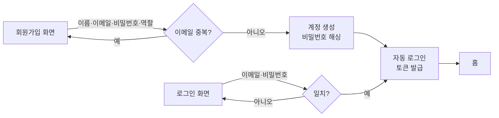
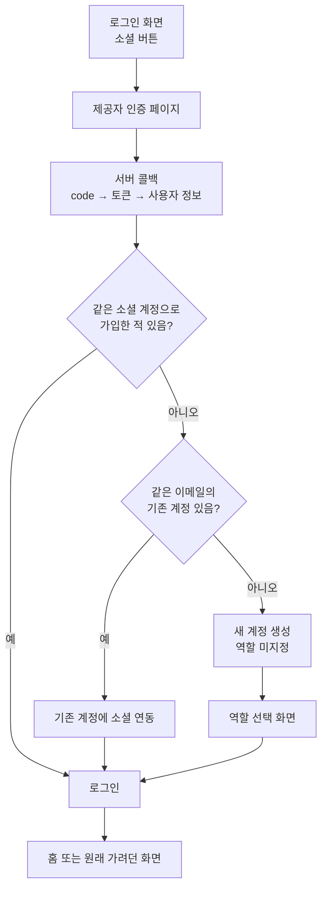
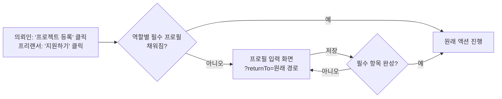
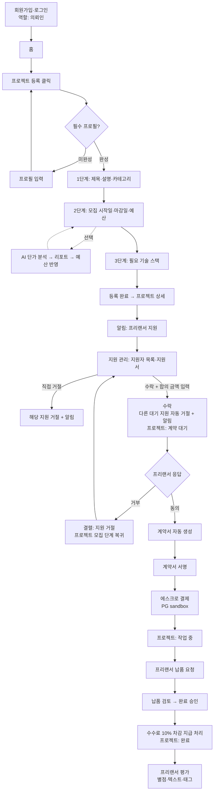
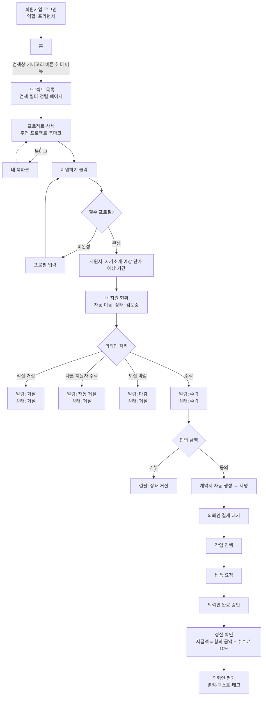
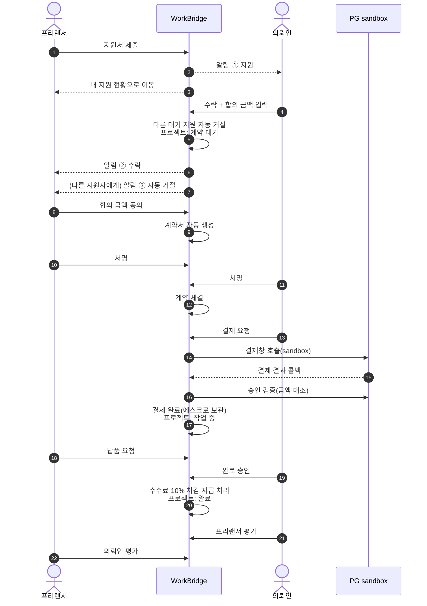
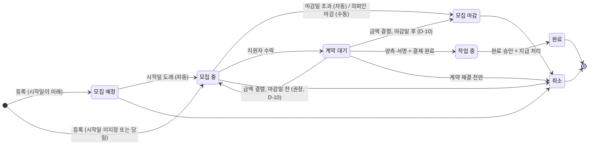
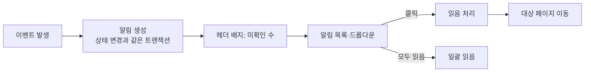
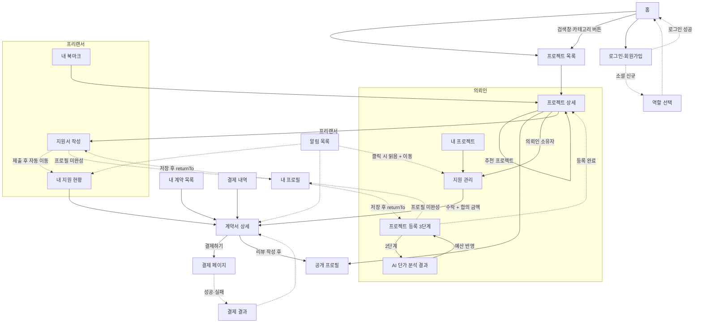

# WorkBridge 사용자 흐름

> 근거: RFP 2부 §2 주요 유저 시나리오, §3 기능 요구사항, §7.3 UX 원칙
> 요구사항 ID는 [REQUIREMENTS.md](./REQUIREMENTS.md), 결정 항목 `D-xx`는 [DECISIONS.md](./DECISIONS.md)를 따른다.
> 화면 이름과 URL은 초안이며 팀 자율이다(RFP 2부 §6).

## 0. 표기

- **[RFP]**: RFP가 정한 동작
- **[권장]**: RFP가 권장 정책으로 제시한 동작
- **[팀 결정]**: RFP가 정하지 않아 팀이 정해야 하는 동작(결정 전까지 추천안으로 표기)

---

## 1. 공통 흐름

### 1.1 이메일 회원가입·로그인

- [RFP] 가입 직후 프로필 입력을 강제하지 않는다(A-13). 가입 후 바로 홈으로 간다.
- [팀 결정] 가입 직후 자동 로그인 여부: 추천안은 자동 로그인(D-25).

### 1.2 소셜 로그인

- [RFP] 같은 이메일이면 기존 계정과 연동한다(A-06). 최초 소셜 로그인 시 역할 선택 페이지로 보낸다(A-07).
- [팀 결정] 제공자가 '검증된 이메일'을 줄 때만 연동할지(D-24), 제공자 선택(D-23).
- [팀 결정] 역할을 고르지 않은 사용자가 다른 화면에 접근하면 역할 선택으로 다시 보낸다.

### 1.3 토큰 재발급과 로그아웃

- [RFP] Access Token이 만료되면 Refresh Token으로 자동 재발급하고 사용자는 그대로 이용한다(A-03).
- [RFP] 로그아웃 시 클라이언트 토큰 삭제. 서버 무효화는 선택(A-04, D-26).

### 1.4 프로필 보완 흐름 (차단형 흐름의 복귀)

- [RFP] 등록·지원 시점에 필수 프로필이 비어 있으면 프로필 입력으로 보낸 뒤 원래 액션으로 복귀시킨다(A-13, N-10).
- [팀 결정] 무엇이 '필수 프로필'인지(D-05). 추천안: 의뢰인은 회사명·사업 분야, 프리랜서는 활동 카테고리·기술 스택 1개 이상·경력·시간당 단가.
- [팀 결정] 검사 시점: 추천안은 버튼을 누르는 시점(등록 퍼널 진입 전, 지원서 작성 화면 진입 전)에 먼저 검사하고, 서버도 등록·지원 API에서 한 번 더 검사한다. 입력 중 내용을 잃지 않게 하기 위해서다.

---

## 2. 의뢰인 전체 흐름

| 단계 | 화면 (초안) | 동작 | 요구사항 |
|---|---|---|---|
| 1 | 회원가입 | 의뢰인 역할로 가입 | A-01, A-08 |
| 2 | 홈 → 프로젝트 등록 | 필수 프로필이 없으면 프로필 입력 후 복귀 | A-13 |
| 3 | 등록 퍼널 1~3단계 | 기본 정보 → 일정·예산 → 기술 스택. 등록 시 시작일에 따라 '모집 예정' 또는 '모집 중' | A-15, A-24 |
| 3-1 | AI 단가 분석 결과 | (선택) 2단계에서 분석 요청 → 리포트 → '예산 반영' | B-01~B-03, D-28 |
| 4 | 프로젝트 상세 | 등록 직후 상세로 이동, 수정·삭제·마감·취소 버튼 | A-16~A-18, A-27, N-09 |
| 5 | 알림 | 지원 알림 수신 → 클릭 시 지원 관리로 이동 | A-36 ① |
| 6 | 지원 관리 | 지원서 열람, 직접 거절 또는 수락 | A-31, A-32 |
| 7 | 수락 모달 | 합의 금액 입력 후 수락 → 다른 대기 지원 자동 거절, 프로젝트 '계약 대기' | B-04, A-33, A-25 |
| 8 | 내 프로젝트 / 계약서 상세 | 프리랜서의 동의를 기다림. 거부 시 결렬 처리 | B-05 |
| 9 | 계약서 상세 | 자동 생성된 계약서 확인 → 서명(체크박스) | B-06, B-07 |
| 10 | 결제 페이지 → 결과 | 양측 서명 후 '결제하기' → PG 결제창 → 서버 검증 → 프로젝트 '작업 중' | B-09, B-11 |
| 11 | 계약서 상세 | 납품 요청 확인 → 완료 승인 → 수수료 차감 지급 처리 → '완료' | B-13, B-14 |
| 12 | 리뷰 폼 | 프리랜서 평가(1회, 수정 불가) | B-15, B-16, B-18 |
| 상시 | 결제 내역, 내 프로젝트, 알림 목록 | 결제 내역 조회, 세부 상태 확인, 일괄 읽음 | B-10, A-28, A-38 |

---

## 3. 프리랜서 전체 흐름

| 단계 | 화면 (초안) | 동작 | 요구사항 |
|---|---|---|---|
| 1 | 회원가입 | 프리랜서 역할로 가입 | A-01, A-08 |
| 2 | 홈 → 프로젝트 목록 | 헤더·검색창·카테고리 버튼으로 진입. 키워드, 카테고리, 예산, 기술, 마감일, 모집 상태 필터. 최신·마감임박·예산 높은순 정렬. 10개씩 | A-19~A-23, A-26 |
| 3 | 프로젝트 상세 | 지원자 수·상태·추천 프로젝트 확인, 북마크 토글 | A-18, A-39, A-41 |
| 4 | 지원서 작성 | 필수 프로필이 없으면 프로필 입력 후 지원서로 복귀. 같은 프로젝트 중복 지원 불가 | A-13, A-29 |
| 5 | 내 지원 현황 | 제출 직후 자동 이동. 검토중/수락/거절 추적. 처리 후에도 결과가 남음 | A-30, A-35 |
| 6 | 알림 | 수락·자동 거절·직접 거절·마감 알림 수신 | A-36 ②~⑤ |
| 7 | 금액 제안 응답 | 의뢰인이 입력한 합의 금액에 동의 또는 거부 | B-04, B-05 |
| 8 | 계약서 상세 | 자동 생성된 계약서 서명. 의뢰인 결제 완료 후 작업 시작 | B-06~B-08, B-11 |
| 9 | 계약서 상세 | 작업 완료 후 납품 요청 | B-12 |
| 10 | 계약서 상세 | 완료 승인 후 정산 정보(결제액·수수료·지급액) 확인 | B-14 |
| 11 | 리뷰 폼 | 의뢰인 평가(1회, 수정 불가) | B-15, B-17, B-18 |
| 상시 | 내 북마크, 공개 프로필 | 북마크에서 상세 진입·지원, 받은 리뷰와 평균 별점 확인 | A-40, B-19 |

---

## 4. 양측 상호작용 (지원 → 리뷰)

- [팀 결정] 서명 순서는 정하지 않는다. 양측이 모두 서명하면 체결된다.
- [팀 결정] 거래 단계 알림(동의/거부, 서명 완료, 결제 완료, 납품 요청, 완료 승인, 평가 요청)은 도전 과제 C-01이다. 필수는 아니지만, 화면 안내(계약서 상세의 상태별 버튼)로 다음 행동을 알 수 있게 한다.

---

## 5. 거래 실패 흐름 (RFP 2.3)

| 상황 | 트리거 | 처리 | 알림 | 요구사항 |
|---|---|---|---|---|
| 자동 거절 | 의뢰인이 다른 지원자 수락 | [RFP] 같은 프로젝트의 다른 대기 지원을 모두 '거절'. 내 지원 현황에 결과가 남음 | [RFP] 거절된 프리랜서 각각 (③) | A-33, A-35 |
| 직접 거절 | 의뢰인이 거절 | [RFP] 해당 지원 '거절' | [RFP] 해당 프리랜서 (④) | A-32 |
| 수동 마감 | 의뢰인이 마감 처리 | [RFP] 프로젝트 '모집 마감', 미처리 지원 일괄 '거절' | [RFP] 지원자 전원 (⑤) | A-24, A-34 |
| 자동 마감 | 마감일 초과 | [RFP] 프로젝트 '모집 마감', 미처리 지원 일괄 '거절' | [RFP] 2.3은 "지원자 전원에게 알림"을 말하지만 3.3.1 필수 5종은 '의뢰인의 마감 처리'만 명시. [팀 결정] 추천안은 자동 마감에도 같은 알림 발송(D-36) | A-24, A-34 |
| 금액 합의 결렬 | 프리랜서가 합의 금액 거부 | [권장] 해당 지원 '거절', 프로젝트는 계약 직전 단계로 복귀, 자동 거절된 지원자는 복구하지 않음. [팀 결정] 복귀 상태(D-10) | 필수 아님(C-01) | B-05 |
| 프로젝트 취소 | 의뢰인이 취소 | [RFP] 계약 체결 이전 단계에서만 가능. 체결 후에는 정상 완료 또는 환불 흐름. [팀 결정] 남은 지원·진행 중인 계약 처리(D-13) | 필수 아님 | A-27 |
| 프로젝트 삭제 | 의뢰인이 삭제 | [RFP] 소프트 딜리트. [팀 결정] 삭제 가능 상태와 남은 지원 처리(D-07) | 필수 아님 | A-17 |

---

## 6. 프로젝트 상태 흐름 (RFP 3.2.3)

- [RFP] 지원자 수락으로 거래 단계에 들어가는 것도 '모집 마감'의 한 형태이며, 이때 미처리 지원은 일괄 거절된다(3.2.3). 외부 목록에서는 계약대기·작업중·완료가 모두 '모집 마감'으로 보인다(A-26).
- [팀 결정] 마감된 프로젝트에서 수락할 수 있는지(D-34). 마감 시 미처리 지원은 모두 거절되므로 수락할 대기 지원이 남지 않는다. 추천안은 '모집 중'에서만 수락 가능(다이어그램도 이 기준).
- [팀 결정] '계약대기' 안의 세부 단계(금액 합의 중 → 서명 대기 → 결제 대기)는 계약 상태로 표현한다(D-03, D-04). [ERD_DRAFT.md §3](./ERD_DRAFT.md) 참고.

---

## 7. 알림 흐름

| # | 이벤트 | 수신자 | 클릭 시 이동 (추천안, D-36) | 구분 |
|---|---|---|---|---|
| ① | 프리랜서 지원 | 의뢰인 | 해당 프로젝트 지원 관리 | 필수 |
| ② | 지원 수락 | 수락된 프리랜서 | 금액 제안 응답(계약서 상세) | 필수 |
| ③ | 타 지원 수락에 의한 자동 거절 | 거절된 프리랜서 각각 | 내 지원 현황 | 필수 |
| ④ | 직접 거절 | 해당 프리랜서 | 내 지원 현황 | 필수 |
| ⑤ | 모집 마감 처리 | 지원자 전원 | 내 지원 현황 | 필수 |
| ⑥~⑪ | 합의 동의/거부, 서명 완료, 결제 완료, 납품 요청, 완료 승인, 평가 요청 | 상대 당사자 | 계약서 상세 | 도전(C-01) |

- [RFP] 미확인 알림은 헤더에서 즉시 식별, 클릭 시 자동 읽음, 목록에서 일괄 읽음(A-37, A-38).
- [팀 결정] 갱신 방식(D-37): 추천안은 주기적 조회(폴링) + 화면 이동 시 갱신. 실시간 소켓은 MVP 범위에서 제외.

---

## 8. 헤더와 화면 목록

### 8.1 로그인 상태별 헤더 (A-42)

| 상태 | 메뉴 |
|---|---|
| 비로그인 | 프로젝트 찾기, 로그인, 회원가입 |
| 의뢰인 | 프로젝트 찾기, 프로젝트 등록, 내 프로젝트, 내 계약, 알림(미확인 배지), 내 프로필, 로그아웃 |
| 프리랜서 | 프로젝트 찾기, 내 지원 현황, 내 북마크, 내 계약, 알림(미확인 배지), 내 프로필, 로그아웃 |
| 역할 미선택(소셜 신규) | 역할 선택 화면으로 고정 |

### 8.2 화면 목록 (RFP 2부 §6 기준 + 흐름상 필요한 화면)

| 구분 | 화면 | RFP §6 | 요구사항 |
|---|---|---|---|
| 기본 | 홈(랜딩): 검색창, 카테고리 버튼, 최신 프로젝트 | ✅ | A-19, A-42 |
| 기본 | 프로젝트 목록 | ✅ | A-20~A-23, A-26 |
| 기본 | 프로젝트 상세(추천 섹션 포함) | ✅ | A-18, A-39, A-41 |
| 기본 | 프로젝트 등록(3단계)/수정 | ✅ | A-15, A-16 |
| 기본 | 회원가입/로그인 | ✅ | A-01, A-02, A-05 |
| 기본 | 역할 선택 | 흐름상 필요 | A-07 |
| 기본 | 내 프로필(역할별 입력, returnTo 복귀) | ✅ | A-09~A-11, A-13 |
| 기본 | 사용자 공개 프로필 | ✅ | A-14, B-19 |
| 기본 | 지원서 작성 | 흐름상 필요 | A-29 |
| 기본 | 지원 관리(의뢰인) | ✅ | A-31, A-32 |
| 기본 | 내 지원 현황(프리랜서) | ✅ | A-30, A-35 |
| 기본 | 내 프로젝트(의뢰인) | ✅ | A-28 |
| 기본 | 내 북마크(프리랜서) | ✅ | A-40 |
| 기본 | 알림 목록 | ✅ | A-38 |
| 심화 | AI 단가 분석 결과(등록 퍼널 안 패널 또는 모달) | ✅ | B-01~B-03 |
| 심화 | 계약서 상세(서명, 결제, 납품, 승인, 정산 정보, 리뷰를 상태별 버튼으로 통합) | ✅ | B-06~B-08, B-11~B-18 |
| 심화 | 내 계약 목록 | 흐름상 필요(계약서 상시 조회) | B-08 |
| 심화 | 결제 페이지/결과 | ✅ | B-09 |
| 심화 | 결제 내역 | ✅ | B-10 |

- [팀 결정] 납품 요청·완료 승인·리뷰를 별도 페이지로 만들지 않고 계약서 상세에 상태별 버튼으로 통합하는 것을 추천한다. RFP 3.6.3이 허용하는 방식이고 화면 수가 줄어든다.

### 8.3 화면 이동 관계 (사이트맵)

화살표는 "이 화면에서 저 화면으로 이동할 수 있다"는 뜻이다. 점선은 조건부 이동(로그인 필요, 프로필 미완성, 액션 완료 후 자동 이동)이다.

---

## 9. 반응형·사용성 기준 (RFP 7.3 + 팀 결정)

| 구분 | 기준 | 근거 |
|---|---|---|
| [RFP] | 등록·지원·결제 후 다음 단계로 자동 이동(등록 → 상세, 지원 → 내 지원 현황, 결제 → 계약서 상세) | 7.3, A-30 |
| [RFP] | 프로필 완성 유도 후 원래 액션으로 복귀(`returnTo`) | 7.3, A-13 |
| [RFP] | 미확인 알림은 헤더 배지로 즉시 식별 | 7.3, A-37 |
| [RFP] | 로그인 전·후 헤더 메뉴 구분 | 7.3, A-42 |
| [팀 결정] | 반응형: 모바일(360px)·데스크톱(1280px) 2단계만 맞춘다. 목록은 모바일에서 1열 카드, 필터는 접이식 패널, 헤더 메뉴는 햄버거 메뉴 | D-50 |
| [팀 결정] | 모든 목록·상세에 로딩·빈 상태·에러 화면을 둔다(예: "아직 지원한 프로젝트가 없습니다" + 프로젝트 찾기 버튼) | D-50 |
| [팀 결정] | 되돌릴 수 없는 액션(수락, 거절, 마감, 취소, 서명, 완료 승인, 리뷰 제출)은 확인 모달을 띄운다 | D-50 |
| [팀 결정] | 상태는 글자 + 색 배지로 함께 표시한다(색만으로 구분하지 않음) | D-50 |
